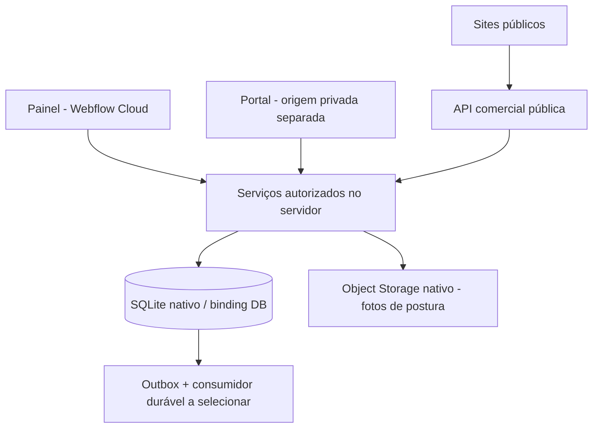

# Arquitetura atual — Webflow Cloud Apps + SQLite

O usuário confirmou duas decisões: hospedagem no Webflow Cloud Apps e tabelas no próprio ambiente Webflow. A proposta anterior de PostgreSQL/Supabase foi substituída. Os três arquivos em `docs/referencias` permanecem inalterados como fontes históricas; este documento prevalece para runtime, armazenamento e autorização.

## Stack e fontes oficiais

- Next.js/React com OpenNext para o runtime Workers do Webflow.
- **SQLite gerenciado pelo Webflow**, acessado pela API D1 via binding `DB`.
- SQL versionado manualmente em `migrations/`; Drizzle é usado somente pelo adapter Better Auth; repositories de domínio usam SQL parametrizado.
- Object Storage nativo para futuros arquivos/PDFs, com autorização antes da entrega. KV poderá ser usado para caches adequados, não como livro financeiro ou fonte de revogação imediata.

Referências oficiais consultadas nesta revisão:

- [Storage nativo e bindings](https://developers.webflow.com/webflow-cloud/storing-data/overview)
- [SQLite, migrations e desenvolvimento local](https://developers.webflow.com/webflow-cloud/storing-data/sqlite)
- [Adicionar SQLite a um app](https://developers.webflow.com/webflow-cloud/add-sqlite)

Essas páginas confirmam provisionamento por `wrangler.json`, bindings por ambiente, migrations automáticas no deploy e acesso Next.js por `getCloudflareContext()`. O código inicial Next seguiu também o starter oficial `Webflow-Examples/hello-world-nextjs`, commit `c1e2207bb15071ea2673ff6e7b47d040133e1bfa`.

## Topologia

Esta base é um app na raiz do repositório, com módulos internos. Sites e portal serão separados por origem quando implementados. Rotas diferentes no mesmo host não isolam dados privados dos scripts de marketing. O painel agora tem login e dados de alunos. Deve ser publicado em origem privada dedicada, sem scripts de marketing. O portal separado ainda será implementado.

## Modelo inicial

| Tabela | Papel |
|---|---|
| users | Identidade interna e bloqueio; mesmo ID da identidade Better Auth após onboarding |
| organizations | Tenant e fuso de atendimento |
| memberships | Papel por organização e revogação |
| professionals | Profissional vinculado a membership da mesma organização |
| students | Cadastro mínimo de atendimento por organização |
| care_assignments | Responsabilidade técnica explícita |
| student_access | Vínculo explícito entre login e cadastro de aluno |
| app_schema_versions | Versão necessária para a prontidão do banco |
| platform_admins | Gestor da ferramenta (0003). Sem vínculo técnico com alunos |
| student_invites | Convite de uso único do aluno; só o hash do token (0003) |
| access_audit_events | Auditoria de acessos: gestor, bloqueios, convites, revogações (0003) |
| training_plans | Plano de periodização de um aluno (0004). Só quem tem vínculo técnico lê ou escreve |
| plan_revisions | Revisões do plano com entrada, cronograma recalculado no servidor e estado (0004). Um rascunho aberto por plano |
| training_plan_events | Trilha de ações sobre o plano, sem conteúdo (0004) |
| assessments | Avaliação datada (inicial ou reavaliação): seis itens de triagem e `risk_status` que o banco amarra às marcas. Rascunho editável; registrada é imutável por gatilhos (0009) |
| assessment_metrics | Indicadores da avaliação: texto digitado, valor numérico quando simples, unidade e lado. Mudam só em rascunho (0009) |
| assessment_reviews | Revisão do alerta pelo profissional, só de acréscimo, com a base escrita por ele. Não apaga o alerta (0009) |
| workout_sessions, session_exercises, session_sets | O diário do aluno: um registro por treino e dia, apontando para a revisão entregue e para os exercícios prescritos; nada é copiado de volta para a prescrição. Congela por gatilho com relato de dor ou depois da leitura do profissional (0012) |
| session_acknowledgements | A leitura do profissional sobre um registro (quem, quando, anotação): só se acrescenta, nunca se muda (0012) |
| terms_versions | As palavras dos termos publicadas pelo gestor: uma linha imutável por versão e público (JSON, SHA-256, quem, quando, por quê). A mais recente é a em vigor; antes de qualquer uma vale o texto inicial, que está no código. Só gestor ativo insere (0016) |
| consent_acceptances | O aceite dos termos por pessoa e papel (profissional ou aluno): versão, SHA-256 do texto aceito, autorização opcional de fotos (só aluno) e data. Só se acrescenta; a linha mais recente é o estado (0013) |
| student_checkins, checkin_acknowledgements | O check-in do aluno (um por dia: esforço, recuperação, desconforto, observações) e a leitura do profissional, que só se acrescenta. Relato de desconforto e check-in lido congelam por gatilho; só o login ligado ao aluno pode inserir (0015) |
| email_messages | O registro do e-mail que a ferramenta envia (hoje só o link de nova senha): endereço em minúsculas, resultado (`SENT`, `FAILED`, `THROTTLED`) e código do erro do provedor. Conta os envios para o limite por endereço e por hora; **nunca guarda o link, o token nem o texto** (o banco recusa texto para qualquer provedor que não seja a captura local dos testes) (0018) |
| data_subject_requests, data_subject_request_outcomes, photo_erasures | Pedidos do titular: o que o aluno pediu (acesso, correção, apagar fotos, exclusão, retirada do aceite, outro), o prazo de 15 dias e a resposta do profissional, que só se acrescentam (uma resposta por pedido, o aluno não responde o próprio). `photo_erasures` registra a foto apagada a pedido, com o pedido e quem apagou; só nasce sob um pedido aberto do mesmo aluno, por profissional com vínculo, e não mexe nas linhas congeladas de `assessment_photos` (0017) |
| assessment_photos | Índice das fotos de postura (quatro vistas por avaliação): a imagem fica no Object Storage (`PHOTOS`), nunca no banco nem em endereço público; congela com a avaliação (0011). Cada foto aponta para o aceite do aluno que a autorizou (`consent_acceptance_id`, 0014), e um gatilho recusa foto sem ele |
| assessment_findings | Achados posturais marcados e testes de movimento com a escala do documento; só linhas registradas, congeladas com a avaliação (0010) |
| student_profiles | Ficha do aluno (dado pessoal e de saúde): uma linha por aluno, só profissional com vínculo técnico (0008) |
| prescribed_exercises | Exercício prescrito numa revisão: instantâneo de nome e vídeo, dose em texto livre, origem. Só muda em rascunho (0006) |
| exercises | Biblioteca: `organization_id` nulo é o sistema (somente leitura, seed de 64); senão pertence à organização. `name_key` calculado no código decide duplicidade (0005) |

O Object Storage nativo (R2, binding `PHOTOS`, **aberto em produção desde a 0.24.1** pela variável `PHOTOS_ENABLED`, e só com a autorização do aluno) guarda as fotos de postura (0.14): o bucket não tem endereço público, a chave é imprevisível e a leitura passa por rota autenticada que confere o vínculo técnico; o banco guarda só o índice. O PDF do plano entregue (0.11) não tem tabela: `src/modules/pdf/plan-pdf.ts` o gera sob demanda com pdf-lib, a partir da revisão entregue (imutável). Cada download grava `PLAN_PDF_DOWNLOADED` em `access_audit_events`. Nenhum arquivo é guardado, porque o Worker não tem disco persistente.

IDs de domínio são UUIDs gerados pelo servidor. As identidades Better Auth usam IDs próprios. Datas usam UTC ISO-8601; o calendário usa timezone IANA. Foreign keys compostas impedem cruzar organização, aluno e profissional. Futuros valores monetários serão inteiros em centavos e percentuais em pontos-base.

As migrations Supabase da primeira proposta nunca foram aplicadas remotamente nem publicadas e foram substituídas antes do primeiro envio da base. A partir do primeiro deploy, não editar/remover migrations aplicadas: acrescentar novas migrations.

## Áreas por papel — versão 0.3

A aplicação tem três áreas (`/gestor`, `/profissional`, `/aluno`) mais a demonstração opcional. O papel de cada identidade é recalculado no servidor a cada requisição (`src/db/surfaces.ts`): gestor = `platform_admins` ativo; profissional = `memberships` ativa; cliente = `student_access` ativo. Layouts só desenham a moldura; cada página e ação chama `requirePlatformAdmin`, `requireWorkspace` ou `requireStudent`. Detalhes, matriz e conciliação com o handoff V2 em [ESTRUTURA-E-PAPEIS.md](ESTRUTURA-E-PAPEIS.md).

O gestor opera sobre organizações e contagens. Ele não tem `memberships` nem `care_assignments`, então `studentsFor` e os repositories de atendimento nunca devolvem alunos a ele. O portal do aluno continua na mesma origem do painel nesta fatia; a separação de origem segue obrigatória antes de dados reais de alunos.

## Autorização sem RLS

SQLite/D1 não oferece as policies RLS do PostgreSQL. O binding autoriza o **servidor do app a acessar o banco**, não autoriza automaticamente um usuário a ler alunos.

`src/db/students.ts` exige contexto de usuário/organização e restringe cada consulta por organização e vínculo ativo. Um proprietário, comercial, financeiro ou operador de suporte não recebe acesso técnico universal. As consultas reavaliam revogação e bloqueio da identidade; os valores são parâmetros SQL, não concatenação de input.

`requireIdentity` e `requireWorkspace` derivam `AuthenticatedContext` de sessão validada e organização resolvida. Nunca construir esse contexto a partir de `userId`, `organizationId`, headers livres ou JSON enviados pelo navegador. Os testes de autorização fornecem identidades controladas; os novos testes de autenticação e navegador também exercitam contas, cookies, sessões, logout e onboarding reais. As páginas e ações de alunos autenticam cada acesso. O acesso bruto ao binding é privilegiado e deve permanecer em código do servidor; não há uma segunda camada RLS se um futuro desenvolvedor contornar o repository.

Use operações D1 suportadas como `batch()` para efeitos que devem ser atômicos. O teste de rollback verifica que uma falha de foreign key desfaz todo o batch. Não importar transações PostgreSQL, funções `auth.uid()`, `service_role`, extensions ou pgvector para SQLite.

## Regras de produto preservadas

- Uma identidade não une atendimentos entre organizações; cada contexto continua separado.
- Revisões entregues são imutáveis, execução aponta para revisão exata e edição humana deve ser preservada.
- Aprovação, entrega de treino, publicação de site e confirmação de pagamento são atos distintos.
- Afiliados recebem sobre pagamentos **SaaS** confirmados; receitas do profissional são outro livro.
- IA não aprova treino nem inventa evidências. Recuperação vetorial/RAG precisará de desenho compatível com o novo armazenamento; pgvector deixa de ser pressuposto.
- Origem privada sem pixels/GTM. URLs, assets, sessões e APIs terão autorização própria.

## Limites de runtime ainda relevantes

O runtime Workers não é um servidor Node permanente. Não persistir em disco de produção nem depender de promises que continuam após a resposta. Jobs/PDF devem usar execução durável cuja disponibilidade no Webflow será validada; não presumir que todo produto Cloudflare está exposto.

A montagem `basePath`/`assetPrefix` é configurada pelo builder Webflow; links usam `next/link`. Domínios compartilhados por tenants, TLS, login cross-domain, Puck e Object Storage privado ainda precisam de prova no ambiente remoto. O provisionamento nativo do DB não resolve essas fronteiras.

## Identidade e onboarding — versão 0.2

Better Auth usa as tabelas `auth_user`, `auth_session`, `auth_account`, `auth_verification` e `auth_rate_limit` no mesmo binding DB. Drizzle adapta SQLite/D1; `transaction: false` evita BEGIN interativo incompatível. O cadastro de credencial é gerido pela biblioteca e não tem a atomicidade multioperação dos batches de domínio; falhas parciais de criação de conta devem ser verificadas em homologação antes de abrir cadastros públicos.

A migration 0002 acrescenta essas tabelas, `organization_provisioning` (provisionamento único por identidade) e `audit_events`. A 0001 permanece inalterada. Organização, membership OWNER, profissional e auditoria usam `DB.batch`; aluno, atribuição ao profissional autenticado e auditoria também. Sem vínculo técnico ativo, não há escrita. Um OWNER sem atribuição continua sem acesso universal a alunos.

A organização ativa vem da primeira membership ativa ordenada pelo servidor. Esta fatia cria um espaço por identidade; seleção de múltiplos espaços e convites ainda não possuem interface. E-mails ainda não são verificados e nunca autorizam vínculo automático com aluno ou organização. Ver [autenticação](AUTENTICACAO.md) para limites e operação.

## Papéis e convites — versão 0.3

A migration 0003 é aditiva (0001 e 0002 permanecem iguais). `access_audit_events` valida a ação no código e não por `CHECK`, para que novos eventos não exijam reconstruir a tabela. O aceite de convite e a ativação do gestor usam `DB.batch` com `changes()` para encadear efeitos de forma atômica; os testes cobrem concorrência, reenvio, expiração e revogação. A ativação do primeiro gestor depende de `PLATFORM_SETUP_TOKEN` e só funciona enquanto não houver gestor ativo.
