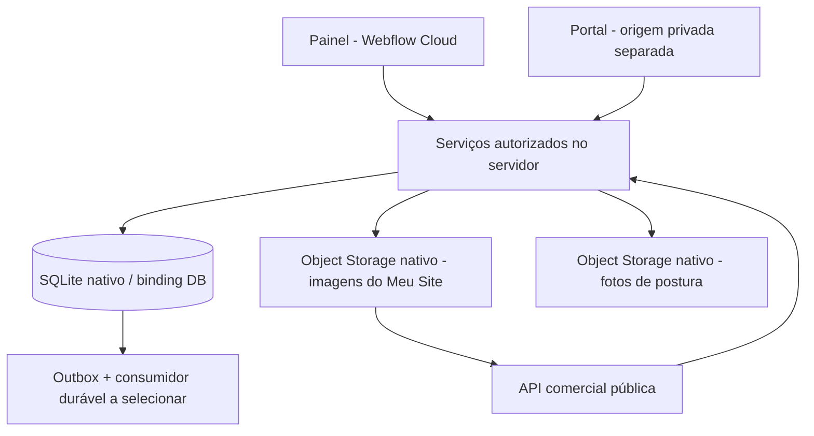

# Arquitetura atual — Webflow Cloud Apps + SQLite

O usuário confirmou duas decisões: hospedagem no Webflow Cloud Apps e tabelas no próprio ambiente Webflow. A proposta anterior de PostgreSQL/Supabase foi substituída. Os três arquivos em `docs/referencias` permanecem inalterados como fontes históricas; este documento prevalece para runtime, armazenamento e autorização.

## Stack e fontes oficiais

- Next.js/React com OpenNext para o runtime Workers do Webflow.
- **SQLite gerenciado pelo Webflow**, acessado pela API D1 via binding `DB`.
- SQL versionado manualmente em `migrations/`; Drizzle é usado somente pelo adapter Better Auth; repositories de domínio usam SQL parametrizado.
- Object Storage nativo para futuros arquivos/PDFs, com autorização antes da entrega. KV poderá ser usado para caches adequados, não como livro financeiro ou fonte de revogação imediata.

Referências oficiais consultadas nesta revisão:

- [Storage nativo e bindings](https://developers.webflow.com/webflow-cloud/storing-data/overview)
- [SQLite, migrations e desenvolvimento local](https://developers.webflow.com/webflow-cloud/storing-data/sqlite)
- [Adicionar SQLite a um app](https://developers.webflow.com/webflow-cloud/add-sqlite)

Essas páginas confirmam provisionamento por `wrangler.json`, bindings por ambiente, migrations automáticas no deploy e acesso Next.js por `getCloudflareContext()`. O código inicial Next seguiu também o starter oficial `Webflow-Examples/hello-world-nextjs`, commit `c1e2207bb15071ea2673ff6e7b47d040133e1bfa`.

## Topologia

Esta base é um app na raiz do repositório, com módulos internos. Sites e portal serão separados por origem quando implementados. Rotas diferentes no mesmo host não isolam dados privados dos scripts de marketing. O painel agora tem login e dados de alunos. Deve ser publicado em origem privada dedicada, sem scripts de marketing. O portal separado ainda será implementado.

## Modelo inicial

| Tabela | Papel |
|---|---|
| users | Identidade interna e bloqueio; mesmo ID da identidade Better Auth após onboarding |
| organizations | Tenant e fuso de atendimento |
| memberships | Papel por organização e revogação |
| professionals | Profissional vinculado a membership da mesma organização |
| students | Cadastro mínimo de atendimento por organização |
| care_assignments | Responsabilidade técnica explícita |
| student_access | Vínculo explícito entre login e cadastro de aluno |
| app_schema_versions | Versão necessária para a prontidão do banco |
| platform_admins | Gestor da ferramenta (0003). Sem vínculo técnico com alunos |
| student_invites | Convite de uso único do aluno; só o hash do token (0003) |
| access_audit_events | Auditoria de acessos: gestor, bloqueios, convites, revogações, pedidos do titular, cópia dos dados e mudança de nome do espaço ou do profissional; quem e quando, nunca o conteúdo (0003) |
| training_plans | Plano de periodização de um aluno (0004). Só quem tem vínculo técnico lê ou escreve |
| plan_revisions | Revisões do plano com entrada, cronograma recalculado no servidor e estado (0004). Um rascunho aberto por plano |
| training_plan_events | Trilha de ações sobre o plano, sem conteúdo (0004) |
| assessments | Avaliação datada (inicial ou reavaliação): seis itens de triagem e `risk_status` que o banco amarra às marcas. Rascunho editável; registrada é imutável por gatilhos (0009) |
| assessment_metrics | Indicadores da avaliação: texto digitado, valor numérico quando simples, unidade e lado. Mudam só em rascunho (0009) |
| assessment_reviews | Revisão do alerta pelo profissional, só de acréscimo, com a base escrita por ele. Não apaga o alerta (0009) |
| workout_sessions, session_exercises, session_sets | O diário do aluno: um registro por treino e dia, apontando para a revisão entregue e para os exercícios prescritos; nada é copiado de volta para a prescrição. Congela por gatilho com relato de dor ou depois da leitura do profissional (0012) |
| session_acknowledgements | A leitura do profissional sobre um registro (quem, quando, anotação): só se acrescenta, nunca se muda (0012) |
| sites | O site de uma organização (0024): um por organização, com o endereço (`slug`) público e único. O endereço não muda enquanto a página está no ar |
| site_drafts | O rascunho do site: o documento (JSON validado) e a `revision`, que sobe de um em um (gatilho). Um salvamento diz a revisão que viu |
| site_releases | As versões publicadas, **imutáveis** (gatilhos): documento como estava na hora, com os serviços escolhidos escritos nele, a revisão do rascunho de onde veio e o SHA-256. Numeradas 1, 2, 3 sem falhas |
| site_published | O ponteiro para a versão que está no ar (0024). Sem linha, não há página pública. A chave composta só deixa apontar para uma versão do próprio site |
| site_assets | O índice das imagens do site (0025): a imagem em si está no bucket `SITE_MEDIA`. Só JPEG ou PNG, até 5 MB e 8192 px de lado; chave do objeto única e imprevisível, SHA-256 do arquivo guardado. **Imutável** (gatilho), no máximo 60 por site (gatilho) e **não se apaga uma imagem que uma versão publicada usou** (gatilho) |
| site_release_assets | Quais imagens cada versão publicada usa (0025). É **por aqui** que a rota pública decide se serve uma imagem: ela precisa estar na versão para onde o ponteiro aponta. Chaves compostas só deixam ligar versão e imagem do mesmo site; só se acrescenta (gatilhos) |
| service_offerings | Os serviços que o profissional oferece (0023): nome único por organização sem diferenciar maiúsculas, descrição, entrega (presencial, online, os dois) e se está na oferta. Sem preço |
| leads | Um interessado que ainda não é aluno (0023): nome, e-mail e/ou telefone com as chaves de duplicidade, origem, serviço, etapa do funil, motivo da perda e, depois de convertido, o aluno. O banco recusa perdido sem motivo, lead sem contato, converter sem contratar, lead convertido que muda ou é apagado, e dois leads para um aluno |
| lead_events | A linha do tempo de um lead (0023): criado, etapa, anotação, dados corrigidos, virou aluno. Só acrescenta; só some junto com o lead apagado |
| auth_two_factor | Segundo passo do login (0021, escrita pelo Better Auth): uma linha por conta com o segredo do aplicativo e os códigos de recuperação **cifrados** com o segredo de autenticação, a marca `verified` (um cadastro não confirmado não pede nada ao entrar) e a contagem de erros com a hora do bloqueio. Apagada com a conta e pela redefinição do gestor |
| terms_drafts | O rascunho dos termos de um público (JSON solto, que pode estar incompleto): no máximo um por público, compartilhado entre os gestores ativos, com uma `revision` que sobe de um em um (trava otimista, imposta por gatilho) e o hash do texto em vigor quando começou. Não é versão publicada e nada lê além do editor; publicar remove o rascunho no mesmo `batch` (0020) |
| terms_versions | As palavras dos termos publicadas pelo gestor: uma linha imutável por versão e público (JSON, SHA-256, quem, quando, por quê). A mais recente é a em vigor; antes de qualquer uma vale o texto inicial, que está no código. Só gestor ativo insere (0016) |
| consent_acceptances | O aceite dos termos por pessoa e papel (profissional ou aluno): versão, SHA-256 do texto aceito, autorização opcional de fotos (só aluno) e data. Só se acrescenta; a linha mais recente é o estado (0013) |
| student_checkins, checkin_acknowledgements | O check-in do aluno (um por dia: esforço, recuperação, desconforto, observações) e a leitura do profissional, que só se acrescenta. Relato de desconforto e check-in lido congelam por gatilho; só o login ligado ao aluno pode inserir (0015) |
| platform_admin_invites | Convite de gestor: só o SHA-256 do link, quem emitiu, o lembrete, o prazo de 48 horas e quem aceitou ou cancelou. Muda uma só vez (aceito ou cancelado) e nunca se apaga; só gestor ativo emite; morre quando quem emitiu deixa de ser gestor (0019) |
| email_messages | O registro do e-mail que a ferramenta envia (hoje só o link de nova senha): endereço em minúsculas, resultado (`SENT`, `FAILED`, `THROTTLED`) e código do erro do provedor. Conta os envios para o limite por endereço e por hora; **nunca guarda o link, o token nem o texto** (o banco recusa texto para qualquer provedor que não seja a captura local dos testes) (0018) |
| data_subject_requests, data_subject_request_outcomes, photo_erasures | Pedidos do titular: o que o aluno pediu (acesso, correção, apagar fotos, exclusão, retirada do aceite, outro), o prazo de 15 dias e a resposta do profissional, que só se acrescentam (uma resposta por pedido, o aluno não responde o próprio). `photo_erasures` registra a foto apagada a pedido, com o pedido e quem apagou; só nasce sob um pedido aberto do mesmo aluno, por profissional com vínculo, e não mexe nas linhas congeladas de `assessment_photos` (0017) |
| assessment_photos | Índice das fotos de postura (quatro vistas por avaliação): a imagem fica no Object Storage (`PHOTOS`), nunca no banco nem em endereço público; congela com a avaliação (0011). Cada foto aponta para o aceite do aluno que a autorizou (`consent_acceptance_id`, 0014), e um gatilho recusa foto sem ele |
| assessment_findings | Achados posturais marcados e testes de movimento com a escala do documento; só linhas registradas, congeladas com a avaliação (0010) |
| student_profiles | Ficha do aluno (dado pessoal e de saúde): uma linha por aluno, só profissional com vínculo técnico (0008) |
| prescribed_exercises | Exercício prescrito numa revisão: instantâneo de nome e vídeo, dose em texto livre, origem. Só muda em rascunho (0006) |
| exercises | Biblioteca: `organization_id` nulo é o sistema (somente leitura, seed de 64); senão pertence à organização. `name_key` calculado no código decide duplicidade (0005) |

O Object Storage nativo (R2, binding `PHOTOS`, **aberto em produção desde a 0.24.1** pela variável `PHOTOS_ENABLED`, e só com a autorização do aluno) guarda as fotos de postura (0.14): o bucket não tem endereço público, a chave é imprevisível e a leitura passa por rota autenticada que confere o vínculo técnico; o banco guarda só o índice. **O segundo bucket, `SITE_MEDIA` (0.36), guarda as imagens do Meu Site e é outro bucket de propósito:** foto de postura é dado de saúde, atrás de sessão e de autorização do aluno; imagem do site é o que o profissional escolheu mostrar a qualquer pessoa. Sem bucket público no Webflow Cloud, a página pública não aponta para o bucket: aponta para a rota do app `/s/<endereço>/m/<imagem>` (ver "Imagens do Meu Site" abaixo). O PDF do plano entregue (0.11) não tem tabela: `src/modules/pdf/plan-pdf.ts` o gera sob demanda com pdf-lib, a partir da revisão entregue (imutável). Cada download grava `PLAN_PDF_DOWNLOADED` em `access_audit_events`. Nenhum arquivo é guardado, porque o Worker não tem disco persistente.

**Baixar meus dados (0.28).** Sem tabela nova. `GET /aluno/conta/meus-dados` (rota do servidor, sessão de aluno verificada) monta o arquivo em `src/db/student-export.ts` com as mesmas consultas protegidas pelo vínculo do login que as telas do aluno usam; a forma do arquivo e os textos ficam em `src/modules/pedidos/export.ts`, sem regra de negócio no componente. Cada geração é reservada na trilha (`access_audit_events`, ação `STUDENT_DATA_EXPORTED`, uma linha por vínculo, nunca o conteúdo) **na mesma instrução** que confere o limite de 6 por hora e login; listas acima de 2.000 entradas são cortadas e o arquivo diz que foram. Não há arquivo guardado: o conteúdo é calculado a cada pedido e devolvido com `Cache-Control: private, no-store`. O arquivo não traz identificadores internos nem nada que a tela do aluno não mostre (ficha, avaliações, fotos, anotações do profissional).

**Configurações do profissional (0.29).** Sem tabela nova. `src/db/workspace-settings.ts` altera `organizations.name` (só o proprietário) e `professionals.display_name` (só o próprio profissional) com o espaço e a pessoa vindos da sessão verificada; o `UPDATE` repete o papel, o vínculo não revogado e o login não bloqueado, de modo que uma revogação entre a leitura e a escrita é recusada pelo próprio comando (testado com uma corrida simulada), e a linha de trilha (`WORKSPACE_RENAMED`, `PROFESSIONAL_RENAMED`) só nasce se algo mudou. Os dois nomes são lidos na hora em que são mostrados (convite, área do aluno, PDF e "entregue por"), então mudá-los muda como as entregas já feitas nomeiam quem entregou; o **conteúdo** de uma revisão entregue não muda. A regra do nome (2 a 160 caracteres, texto simples, espaços internos reduzidos) está em `src/modules/configuracoes/contracts.ts`.

**Meu Site (0.34 e 0.35; a árvore de blocos, na 0.37, abaixo).** `sitesFor` e `publishedSiteBySlug` em `src/db/sites.ts`; o documento, os links de contato, o endereço e as regras de publicação em `src/modules/meu-site/contracts.ts`; o renderizador compartilhado pelo editor, pela prévia e pela página em `src/modules/meu-site/renderer.tsx`. **O editor visual (0.35) é só cliente e não tem migration:** o modelo de edição (`editor-model.ts`: inserir, mover, duplicar, remover, com as regras de onde cada bloco cabe e os limites) e o histórico de desfazer (`editor-history.ts`) são funções puras testadas sem tela; a tela (`visual-editor.tsx`, `editor-canvas.tsx`, `editor-library.tsx`, `editor-inspector.tsx`) só as chama. O arrastar e soltar é o do navegador, sem biblioteca. **O documento passou à versão 2** (blocos novos, "2 colunas" com elementos dentro, cor e aparência de uma lista fechada) **e a versão 1 continua sendo lida**: `parseContent` converte em memória, o que está guardado não é tocado (as versões publicadas são imutáveis) e o rascunho antigo abre como versão 2 e é salvo como tal. As cores da página ficam na folha de estilo, por `data-site-accent` e `data-site-mode`, sem `style` embutido (um CSP estrito não o aceitaria), e um teste lê essas regras e confere o contraste de cada par. O documento só tem texto (escapado) e três contatos; **os únicos links nascem dos contatos**, por funções que só aceitam telefone, e-mail e usuário do Instagram. `publish` lê o rascunho, confere o que falta (`publishIssues`), escreve os serviços na versão e grava, **em um `batch`**, a versão, o ponteiro (`INSERT … ON CONFLICT DO UPDATE`) e a linha de auditoria; a condição "o rascunho ainda é a revisão que a pessoa viu" está dentro da instrução que cria a versão. A página pública (`/s/[slug]`) não tem sessão, devolve só o que uma versão no ar diz e responde o mesmo 404 para endereço inexistente, malformado, nunca publicado ou tirado do ar; é `force-dynamic` (sem cache, para tirar do ar valer na hora) e **compartilha a origem com o painel até R3**, por isso não carrega nada de terceiros.

**Árvore livre de blocos e estilos tipados (0.37, sem migration).** O documento passou à **versão 3**: `blocks` é uma árvore (`src/modules/meu-site/contracts.ts`). Um nó é um **contêiner** (`box`, com `tag` de uma lista curta e `children`), um **elemento** (título com nível de 2 a 6, parágrafo, botão, link, imagem) ou uma **seção pronta**; todo nó pode ter um `name` (só para as camadas, nunca impresso) e um `style`. O estilo (`style.ts`) é um objeto estrito de valores tipados (listas fechadas, números em faixa, comprimentos `16px|50%|2.5rem|100vh` conferidos por unidade e faixa de cada propriedade, cores do tema ou `#rrggbb`), e `cssDeclarations` só escreve o que passa pelo esquema, de tabelas ou de padrões fechados: **sem CSS livre, sem classe livre e sem `style` na página**. `site-css.ts` faz uma regra por nó com estilo, chaveada pela classe do próprio identificador repetida três vezes (para valer mais que uma regra padrão da página, como o fundo do botão principal). **A entrega:** a página pública (`/s/[slug]`) liga `/s/[slug]/estilo.css`, uma rota do app, sem sessão, que responde o CSS da versão que o ponteiro nomeia (`Cache-Control: public, no-cache`, `ETag` do SHA-256, mesmo 404 de uma página que não está no ar); o editor e a prévia escrevem a mesma folha dentro da tela (`InlineSiteStyles`), que só os vê. **Limites** (conferidos pelo contrato e de novo pelo modelo de edição): 40 blocos na página, 40 dentro de um contêiner, 8 níveis de contêiner, 200 no total e 150 KB por documento; um aninhamento hostil é recusado **sem recursão** antes de o esquema rodar (`rawDepth`), para não estourar a pilha. **Versões antigas:** `parseContent` lê as versões 1 e 2 e entrega a 3 em memória (o "2 colunas" vira uma linha de dois contêineres com a mesma proporção, usando `flex-grow` e uma base que quebra quando estreita; um lado vazio some, como na página da versão 2); versões publicadas são imutáveis e continuam como foram guardadas. As imagens que um estilo usa (fundo) entram em `referencedAssetIds`, logo em `site_release_assets`, e valem a mesma regra: só são públicas se a versão no ar as usa. **O editor** (`editor-model.ts`, `drop-geometry.ts`, `editor-canvas.tsx`): o modelo é uma função pura sobre a árvore (inserir, mover com recusa de ciclo, de profundidade e de limite, duplicar, remover, subir e descer, sair e entrar num contêiner, agrupar e desagrupar), com **compartilhamento estrutural** (só a linha de contêineres até o bloco é refeita). O canvas desenha a página **como é publicada** (sem moldura dentro dela) e põe por cima uma camada de seleção, de passagem e de soltar **medida dos retângulos que o navegador desenhou**; `drop-geometry.ts` decide, só de retângulos, para qual contêiner e posição vai o bloco arrastado.

**Tema e busca (0.42, sem migration; contrato, folha de estilo e cliente).** O `theme` do documento ganha `font` e `brand` (opcionais) e o modo `auto`; o documento ganha `indexable`. A página **continua sem `style` e sem recurso de terceiro**: o tema chega por atributos na raiz (`data-site-accent`, `-mode`, `-font`, `-width`) e as cores por regras da folha. As paletas prontas e as três fontes estão no CSS estático (`globals.css`), e `tests/meu-site-theme.test.ts` lê as regras e confere cada par com o WCAG AA, os três modos entre si e as fontes com as do modelo de estilo. A **cor da marca** depende da cor escolhida, então a paleta (`brandRules`, de `brand-color.ts`) entra na **folha de estilo gerada** (`buildSiteCss`, a mesma do editor, da prévia e da página pública), antes das regras dos blocos, numa regra com o acento `custom`; só entra um `#rrggbb` validado no esquema e números derivados dele. O modo automático usa `@media (prefers-color-scheme: dark)` (a média é do aparelho de quem visita, também no editor). `generateMetadata` da página pública escreve `robots` conforme `indexable`. Nada disso toca o banco.

**Várias páginas (0.43, sem migration; contrato, rotas públicas e cliente).** O documento continua na versão 3 e ganha `pages` (opcional, até 10): cada uma tem `id`, `slug` (o endereço dela, abaixo do endereço do site), `title` (o nome no menu e na aba), `description` (para buscadores), `inMenu` (ausente é "no menu") e `blocks`; o `blocks` do documento é a **página inicial**. Um botão ou link ganha o destino `page` (`"home"` ou o `id` de uma página), exclusivo com o contato e com o bloco. Os limites de uma página (40 blocos, 200 nós, 8 níveis, 600 nós com os componentes desenhados) valem **por página**, e o site tem um limite próprio (**800 nós somando as páginas**; o tamanho do JSON sobe de 150 mil para 400 mil bytes). Tudo que olha o documento (identificadores únicos, imagens usadas, estilos da folha, serviços resolvidos ao publicar, conferência da publicação) passa a olhar **todas** as páginas e os componentes, que são do site e têm usos em qualquer página. **O banco não muda:** o rascunho e cada versão guardam o documento inteiro, então publicar continua sendo uma versão imutável só, que traz todas as páginas.

*No editor*, a página aberta é mostrada pela função `swapPage`: os blocos dela passam a ser `blocks` e os da página inicial ocupam o lugar dela em `pages`; aplicar a função de novo devolve o documento. Assim **todas as ferramentas que já existiam** (inserir, mover, colar, componentes, alças, camadas) funcionam na página aberta sem saber que há outras, e o que olha o site todo (limite de nós, imagens, componentes) ainda enxerga todas. As operações de página (`page-model.ts`: criar, título, endereço, menu, ordem, duplicar, excluir) são funções puras sobre o documento; excluir uma página tira dos botões e links o destino que levava a ela. Os componentes (`component-model.ts`) agem página por página (`onEveryPage`): excluir, renomear ou mudar um componente alcança os usos de todas as páginas, ou não muda nada.

*Na página pública*, a página inicial continua em `/s/<site>` e as outras ficam em `/s/<site>/<página>` (`src/app/s/[slug]/[page]/page.tsx`; as rotas fixas `m/` e `estilo.css` têm prioridade sobre o segmento dinâmico, e o endereço `m` é reservado). A página inicial e as outras são desenhadas pelo mesmo código (`public-site.tsx`). **Os endereços escritos pelo servidor continuam relativos** à página que os contém, mas agora a página inicial e as outras estão em **níveis diferentes**: da inicial a imagem é `./<site>/m/<id>`, da outra `./m/<id>`; a folha é `./<site>/estilo.css` e `./estilo.css`; o link para a inicial é `./<site>` ou `../<site>`; o link para outra página é `./<site>/<página>` ou `./<página>` (`image-urls.ts`, com um teste que resolve cada um contra o endereço da página, com e sem o mount `/app`). A **folha de estilo é uma só para o site**, e as imagens de fundo saem de `m/` como antes. O menu e os botões que levam a uma página vêm de `site-nav.ts`, passado ao renderizador; sem ele (uma página desenhada sozinha) um botão para página fica de fora, como um botão sem contato. No editor a prévia mostra a página aberta e navega entre elas na própria janela (os links do menu não são seguidos), e `/profissional/meu-site/previa?pagina=<id>` mostra uma página do rascunho. O aviso de "alterações não salvas" deixou de perguntar nos links que só vão a um ponto da mesma página (`#...`), que são os da prévia.

**Formulário de contato da página pública (0.47, migration 0026; fechado por padrão).** É a única escrita pública do app, e por isso tem três portas fechadas e uma tabela de entrada à parte. **Abertura:** `formsGate` (`inquiries.ts`) só abre com `PUBLIC_FORMS_ENABLED` exatamente `"true"` e um `PRIVACY_NOTICE_URL` válido (https, ou http na própria máquina), lidos do Worker ou, na falta, de `process.env` (as duas estradas das fotos); o `wrangler.json` e o ambiente de produção não os têm, e só `scripts/setup-local-auth.mjs` os põe no `.dev.vars` local para os testes de navegador. Depois a chave do **site** (`sites.inquiries_open`, `0` ao nascer, liga e desliga com linha em `access_audit_events`) e o **bloco** `contactForm` no documento (a página publicada guarda o bloco; a chave do site é lida **a cada pedido**, então desligar vale na hora). **Rota:** `POST /s/<slug>/m/contato` (sem sessão, sem cookie; só `application/x-www-form-urlencoded` de até 8 KB, lido com corte) e `GET /s/<slug>/m/enviado`; os dois sob `m/`, que nenhuma página pode usar como endereço. O formulário usa endereço **relativo** (`./<slug>/m/contato` da página inicial, `./m/contato` das outras) e a resposta é um `303` com `Location` relativo, então nada fixa o mount path. Não há verificação de `Origin`: não há sessão a proteger, e o abuso é contido pelos limites. **Tabela:** `site_inquiries` guarda nome, e-mail ou telefone (com as mesmas chaves de um lead), mensagem opcional, a página de origem, o **endereço do aviso de privacidade** que estava ao lado da caixa e o hash do remetente; gatilhos garantem que a mensagem é da organização do site e **nunca é editada** (só o hash pode ser esvaziado). **Porta pública** (`receiveInquiry`): **uma instrução** `INSERT ... SELECT ... WHERE` decide aberto, publicado, o limite do que espera (500), por site (60/h) e por remetente (5/h) e escreve; sem mudança, uma consulta diz se estava fechado ou limitado. A organização vem do site que o endereço nomeia. O hash é um HMAC-SHA256 truncado do `cf-connecting-ip` com o `AUTH_SECRET`, esvaziado depois de uma hora na próxima chegada. **Porta da organização** (`siteInquiriesFor`): lista, conta, converte e apaga só para quem trabalha os leads, com papel e login ativo em cada instrução; **converter** é um lote (inserir o lead com origem `SITE` e a primeira anotação, apagar a mensagem, registrar na trilha), então a segunda tentativa não encontra nada. A mensagem **nunca vira lead por conta própria**: ninguém da organização a aceitou. **Sem** captcha nem script de terceiros (mudariam o aviso de privacidade).

**Salvamento automático do rascunho (0.46, sem migration; só cliente).** O servidor não muda: o salvamento automático chama o mesmo `saveSiteDraft(content, revision)` do botão, com a revisão carregada, então a conferência de concorrência otimista (`UPDATE ... WHERE revision = ?`) vale também para ele e **um salvamento automático nunca sobrescreve** o de outra aba ou de outra pessoa (a resposta é `conflict`). A regra mora em `src/modules/meu-site/autosave.ts`, fora dos componentes: `shouldAutosave` (ligado, com permissão, com alteração, sem salvamento em andamento, sem conflito e sem o conteúdo que o servidor acabou de recusar) e `afterFailure` (um conflito para o salvamento automático até a página ser atualizada; qualquer outra falha só segura o mesmo conteúdo). O `SiteWorkspace` arma um temporizador de 3 segundos que recomeça a cada alteração e chama `save(..., auto)`; a chamada ao servidor ganhou tratamento para a falta de resposta (rede). A escolha de ligar ou desligar é do navegador de quem edita (`localStorage`, lida com `useSyncExternalStore`, ligada por padrão e com caminho de reserva em memória se o navegador não guardar): nada no servidor depende dela. Cada salvamento é um `UPDATE` do rascunho sem linha de auditoria, então a frequência maior não enche o log. O que está no ar continua mudando só em `publish`.

**Modelos de página e de site (0.45, sem migration; só cliente e uma escolha validada na criação).** `src/modules/meu-site/page-models.ts` guarda a lista de **páginas prontas** (`PAGE_MODELS`: Sobre mim, Serviços e planos, Perguntas frequentes, Depoimentos e Contato) e dos **modelos de site** (`SITE_MODELS`: `single`, o padrão e o que sempre existiu, e `complete`). Um modelo de página é uma função que monta blocos com as seções do catálogo (`catalogueItem(key).create()`), então **os identificadores são novos a cada uso** e o que o contrato v3 aceita é o que sai; ele traz só a estrutura e os nomes (o título da página e o texto dos botões que levam aos contatos), **nunca texto de apresentação, preço, promessa ou depoimento**, e os depoimentos vêm com a autorização da pessoa desmarcada. As regras ficam em `page-model.ts` (fora dos componentes React): `addPageFrom` (modelo desconhecido, 10 páginas e o limite de blocos do site são recusados com as mesmas razões de `addPage`), `pageFromModel` (o endereço sai do título e nunca repete o de outra página) e `starterOf` (o documento inicial de cada modelo de site; o completo é a página inicial e quatro páginas na ordem do menu). `sitesFor().create({ slug, title, model })` valida o modelo no servidor com `z.enum(SITE_MODELS)`, com `single` quando nenhum é pedido; **um valor fora da lista é recusado, não adivinhado**, e a identidade e a organização continuam vindo só da sessão. O resultado é um rascunho comum (`site_drafts`), então nada muda na publicação, na versão imutável nem na página pública. Os modelos moram no código: um modelo novo exige deploy.

**Histórico visual de versões (0.44, sem migration; leitura, comparação e cliente).** Cada publicação já guardava o documento inteiro e imutável (`site_releases.content`), então **o banco não muda**: o repositório ganha só uma leitura, `sitesFor().release(número)`, que devolve a versão como foi publicada (com os serviços que ela escreveu na página naquele momento), com a mesma regra de acesso do resto do site (o proprietário, a gestão e o comercial leem; qualquer outro papel, outra organização, um número que não existe ou uma versão guardada que não é um documento recebem nada). A comparação é uma função pura, `release-diff.ts`: pega dois documentos (duas versões, ou uma versão e o rascunho) e diz o que mudou **pelos identificadores que blocos, páginas e componentes mantêm de uma versão para outra**: o que só existe na nova foi acrescentado, o que só existe na antiga foi removido (um contêiner é dito uma vez, sem os blocos de dentro), o que tem outro conteúdo mudou (a lista diz **o quê**, por nome de campo, sem repetir o texto), o que está em outra página ou dentro de outro contêiner mudou de lugar, e uma ordem diferente entre os blocos que ficaram é dita para o lugar, não para cada bloco. Os serviços que a publicação escreveu na página são **deixados de fora** da comparação (o rascunho não os leva): compara-se a escolha. Os blocos acrescentados ou mudados são **marcados na página da nova versão** (`data-diff`, que a folha contorna por fora, sem mudar o layout); só o que existe na nova versão pode ser marcado, o que foi removido aparece apenas na lista. A tela é a mesma prévia: `/profissional/meu-site/previa?versao=<n>` mostra a versão `n`, `?desde=<m>` (ou `rascunho`) diz o que mudou desde outra e marca os blocos, e `?pagina=` escolhe a página (o menu da versão mantém a versão e a comparação). Uma versão que não existe ou um valor que não é número voltam para a prévia do rascunho. A tela só lê: voltar a uma versão continua sendo "Usar como rascunho", que substitui o rascunho e não muda o que está no ar.

**Componentes reutilizáveis (0.41, sem migration; contrato e cliente).** O documento versão 3 ganha a lista opcional `components` (cada um: identificador, nome e a raiz, um nó como os da página) e o nó `component` (o uso: `componentId` e `overrides`, o que o uso muda, por identificador do nó do componente). Tudo é conferido no mesmo `siteContent` (`contracts.ts`): limites de componentes, de nós por componente e de nós desenhados, identificadores sem repetição entre a página e as definições, nenhum componente dentro de outro, e cada uso ainda um nó válido depois de receber o que muda (`applyOverrides`, a única função que junta os dois, usada pelo renderizador, pelos avisos de publicação, por desvincular e pela colagem). Um uso que aponta para um componente que não existe mais é válido (é aviso ao publicar), para um documento nunca ficar sem abrir. O renderizador desenha o uso como uma caixa própria com o componente dentro; **no editor os nós de dentro não são blocos da página** (não levam o identificador que a tela usa para achar blocos), e só o texto que o uso pode mudar é campo (gravado no uso, `overrides.<nó>.<campo>`). A folha de estilo (`site-css.ts`) percorre os nós da página **e** os das definições, uma vez cada. `component-model.ts` tem as operações do editor (criar, usar, desvincular, excluir, renomear, trocar a raiz, o que o uso muda), todas como funções sobre o documento que devolvem um documento que o servidor aceita ou o motivo da recusa; **editar o componente** não tem estado à parte: o editor mostra `componentView` (os nós do componente como a página) e grava de volta com `setComponentRoot`, no mesmo histórico. A cópia leva as definições (`clipboard.ts`). Publicar guarda o conteúdo com as definições dentro: a versão publicada é imutável e continua se desenhando sozinha.

**Modelos de seção (0.40, sem migration; só cliente).** Um modelo **não é um tipo de bloco**: é uma função em `presets.ts` que devolve uma árvore de nós do documento versão 3 (contêineres com `tag`, elementos e, quando é o caso, `styleTablet` e `styleMobile` no próprio nó), com identificadores novos a cada vez. Por isso o servidor, o renderizador, a folha de estilo e o histórico **não mudaram**: o que o modelo produz passa pelo mesmo `siteContent` de qualquer outro conteúdo, e a biblioteca só o lista no grupo `template`. Texto, imagem e depoimento entram vazios; as únicas palavras escritas são nomes de estrutura e o texto dos botões de contato, e a regra "nada inventado" é conferida em teste (`tests/meu-site-presets.test.ts`, com uma lista fechada de palavras). A página pública já omite o que está vazio ou não tem destino (`visible` em `renderer.tsx`), então um modelo recém-adicionado não deixa elementos vazios na página.

**Manipulação direta na tela (0.39, sem migration; só cliente).** Nada novo vai ao servidor: o que as alças, a seleção e a área de transferência produzem é um documento como qualquer outro, e o servidor o confere como sempre. A conta fica fora da tela e é testada sem ela: `handles.ts` (o ponteiro em pixels da página, os valores dentro das faixas de `SPECS`, o encaixe, as linhas de alinhamento, a faixa entre dois blocos), `selection.ts` (a lista de seleção, o intervalo, o laço), `editor-model.ts` (vários blocos: remover, duplicar, agrupar, navegar a árvore) e `clipboard.ts` (o formato, a leitura rigorosa com `parseNode`, a colagem atômica). `block-handles.tsx` só mede o que o navegador desenhou e liga o ponteiro a essas contas; as alças moram **na camada da tela, fora do mundo com zoom** (por isso mantêm o tamanho em qualquer zoom) e cada gesto usa a chave `gesture:` do histórico, que junta o arrasto inteiro em um passo. A área de transferência usa os **eventos** `copy`, `cut` e `paste` do navegador (sem pedir permissão); o menu "Colar" tenta ler o sistema e, se o navegador recusar, usa a última cópia feita dentro do editor. A seleção é uma lista (o último é o principal) mantida pelo editor e reconciliada com o documento a cada desenho.

**Endereços do servidor e avisos de publicação (0.38.1, sem migration).** O mount path do Webflow Cloud (`/app`) é aplicado pelo builder e **não** vem de variável deste repositório; um `` ou `<link>` simples não ganha o prefixo do framework. Por isso o que o **servidor** escreve é **relativo ao endereço em que o navegador já está** (`src/modules/meu-site/image-urls.ts`: a página pública usa `./<endereço>/m/<id>` e `./<endereço>/estilo.css`, a folha usa `./m/<id>`, a prévia `./imagens/<id>`), e só o **editor**, que roda no navegador, monta endereços absolutos a partir do mount path lido da barra de endereço. `SAFE_URL` (`style.ts`) aceita só `/…` ou `./…` e recusa `//`. Um teste resolve cada endereço contra montagens diferentes e outro varre o código do servidor atrás de `NEXT_PUBLIC_BASE_PATH`. A página pública vive em `<mount>/s/<endereço>`: **um domínio próprio, que a serviria na raiz, terá de rever isto** (PENDENCIAS B26). `publishIssues` devolve problemas com `severity` (`blocking` ou `warning`); `publish(revisão, agora, { withWarnings })` devolve `invalid` (algo impede), `warnings` (só avisos; nada foi publicado) ou `published`, confere de novo no servidor e, ao publicar com um aviso de imagem ausente, liga à versão só as imagens que existem.

**Tamanhos de tela do Meu Site (0.38, sem migration).** Cada nó do documento (versão 3) ganha duas chaves opcionais, `styleTablet` e `styleMobile`, com o mesmo `styleSchema` estrito do `style` (o do computador): guardam só o que muda no tablet e no celular. `src/modules/meu-site/screens.ts` tem os tamanhos (`desktop`, `tablet`, `mobile`), as larguras dos quadros (1400, 800 e 420 px), os limites da página (1023 e 576 px) e a cascata (`resolveStyle`: computador, depois as mudanças do tablet, depois as do celular; padding e margin se juntam lado a lado); `hidden` é uma propriedade de estilo que desce até um tamanho dizer o contrário (`isHiddenAt`). `buildSiteCss` (`site-css.ts`) escreve primeiro as regras do computador, depois as do tablet em `(max-width:1023px)`, depois as do celular em `(max-width:576px)` e por último as de ocultar (`display:none`, em faixas de largura que se juntam quando os tamanhos são vizinhos); cada tamanho escreve só as declarações que diferem das do tamanho de baixo, comparadas **depois** de resolvidas (assim uma propriedade que depende de outra segue a principal), e um tamanho que diz "sem imagem" escreve `background-image:none`. A página publicada e a prévia usam `@media`; o editor usa `container: true`: cada quadro é `container: site-frame / inline-size`, as regras são `@container site-frame (...)` e `vw` vira `cqw`, de modo que três quadros de três larguras mostram três tamanhos numa janela só, com as mesmas regras e a mesma ordem da página publicada. O canvas (`editor-canvas.tsx`, `canvas-view.ts`) guarda o zoom e a posição num ref e escreve a transformação no DOM (sem desenhar a página de novo a cada volta da roda); a camada de seleção e a linha de soltar são medidas dos elementos do quadro em edição e ficam fora do mundo transformado. O renderizador aceita um `scope` para os ids de âncora (os quadros repetem a página) e não escreve ids de âncora no editor. Nada disso toca o banco, o servidor ou a rota de estilo, que só passam a ter regras a mais.

**Imagens do Meu Site (0.36, migration 0025).** `siteAssetsFor` e `publishedAssetBySlug` em `src/db/site-assets.ts`; a conferência do arquivo em `src/modules/meu-site/images.ts`; as rotas em `src/app/profissional/meu-site/imagens` (lista, envio, leitura e remoção, com a sessão verificada) e `src/app/s/[slug]/m/[imagem]` (a pública). **Nenhum arquivo enviado é guardado como veio:** o navegador redesenha a imagem (orientação aplicada, até 2000 px, JPEG ou PNG, sem metadados) e o servidor confere a estrutura **de novo** e reescreve só o que desenha a imagem e as cores (PNG: `IHDR`, `PLTE`, `tRNS`, `IDAT`, `IEND`, `sRGB`, `gAMA`, `cHRM`; JPEG: sem EXIF, XMP, comentário nem dado de aplicativo). SVG, GIF e WebP são recusados (SVG leva script; os outros ampliam a superfície a conferir); um bloco crítico desconhecido, dimensões fora do limite ou arquivo cortado também. A imagem **não é decodificada** no servidor, só os marcadores são lidos. Ordem entre dois armazenamentos que não mudam juntos: ao **acrescentar**, o objeto primeiro e depois a linha (se a linha for recusada, o objeto é apagado); ao **remover**, a linha primeiro e depois o objeto (nunca fica linha apontando para o vazio). **Uma imagem só é pública pela versão publicada:** `publish` confere que as imagens do rascunho ainda estão na biblioteca (na leitura e dentro da própria instrução que cria a versão) e grava, no mesmo `batch`, as linhas de `site_release_assets`; a rota pública junta `sites`, o ponteiro e `site_release_assets` e responde 404 igual para tudo o mais. **Efeito que fica:** uma imagem usada por uma versão publicada **não pode mais ser apagada** (a versão é imutável e continua mostrando-a); apagar de verdade uma imagem já publicada (por exemplo, a de uma pessoa que pediu) exigiria um mecanismo novo, listado como pendência. O editor, a prévia e a página compartilham o mesmo renderizador, que recebe um "resolvedor" de endereço de imagem: na página pública é a rota pública, no editor é a rota autenticada.

**Serviços e leads (0.33).** `servicesFor` e `leadsFor` em `src/db/services.ts` e `src/db/leads.ts`; as regras puras (etapas, origens, chaves de e-mail e telefone) em `src/modules/leads/contracts.ts`. Leitura e trabalho: proprietário, gestão e comercial; apagar lead e mudar serviço: proprietário e gestão; o técnico e o financeiro não veem. A organização e a pessoa vêm da sessão, e cada instrução repete a pertença ativa, o papel e o login ativo. Mover um lead repete a etapa que a pessoa viu (conflito se outra pessoa mexeu). `convert` é um `batch`: cria o aluno com a regra de "Novo aluno" (ou liga a um aluno com vínculo técnico ativo do próprio profissional), grava o vínculo no lead, a linha `CONVERTED` e a de auditoria, e a condição "ainda contratado e não convertido" está na instrução que cria o aluno, então duas conversões simultâneas criam um só. `meta.changes` do D1 conta também as linhas apagadas em cascata: comparar com `> 0`, não com `=== 1`.

**Aparelhos conectados e entradas recentes (0.32).** Sem tabela nova. Um gatilho em `auth_session` (`AFTER INSERT`, só se a pessoa tem linha em `users`) grava `SIGN_IN` em `access_audit_events` (ator e sujeito são a própria pessoa; sem IP e sem navegador), e um índice `(actor_user_id, action, created_at)` serve a leitura das últimas entradas. `accountAccessFor(db, userId, sessionAtualId)` em `src/db/account-access.ts`: `devices` lista só as sessões da pessoa que ainda valem (nunca o token nem o IP; o `User-Agent` vira um nome curto em `src/modules/auth/device.ts` e só esse nome sai), `recentSignIns` lê as linhas `SIGN_IN` da própria pessoa e `disconnect` apaga uma sessão repetindo na mesma instrução de quem ela é, que não é a sessão que pede e que o login está ativo, e só então acrescenta `DEVICE_DISCONNECTED`. A sessão que faz o pedido vem de `requireIdentity()` (o id da sessão verificada), nunca do corpo. A biblioteca renova a sessão uma vez por dia, então a tela não mostra "última atividade". A auditoria do gestor lista um conjunto fixo de ações e não inclui `SIGN_IN`.

**Verificação em duas etapas (0.31).** Plugin `twoFactor` do Better Auth em `src/modules/auth/factory.ts` (TOTP de 6 dígitos a cada 30 s; 10 códigos de recuperação de 10 caracteres; desafio de 5 minutos), com a coluna `auth_user.two_factor_enabled` e a tabela `auth_two_factor` da migration 0021. Só cinco rotas ficam abertas em `AUTH_ENDPOINTS` (`enable`, `verify-totp`, `verify-backup-code`, `generate-backup-codes`, `disable`); o envio por e-mail ou SMS e a releitura do segredo não existem para o navegador. Um gatilho em `auth_user` grava `TWO_FACTOR_ENABLED` e `TWO_FACTOR_DISABLED` em `access_audit_events` (ator e sujeito são a própria pessoa; nunca o segredo). A redefinição pelo gestor é `platformFor(...).resetTwoFactor` em `src/db/platform.ts`: um `batch` cuja primeira instrução repete o gestor ativo, "não a si mesmo", a marca ligada e o vínculo da pessoa; a linha `PLATFORM_TWO_FACTOR_RESET` só nasce se ela mudou algo e a exclusão dos segredos e das sessões só acontece se essa linha existe. O QR é desenhado no navegador (`uqr`); o segredo não vai a outro serviço.

**Rascunho dos termos (0.30).** `termsFor(...).saveDraft/draft/discardDraft` em `src/db/terms.ts`. O editor diz o que carregou (`EditorState`: o id da versão em vigor, ou nulo para o texto inicial, e a revisão do rascunho, ou nula para nenhum) e o repositório confere isso **na mesma instrução** que escreve: salvar um rascunho novo só vale se a versão em vigor ainda é a que o editor carregou; salvar por cima exige a revisão certa; **publicar** exige as duas coisas e remove o rascunho. Com mais de um gestor isso impede publicar ou salvar por cima do que outro fez sem ter visto. Descartar deixa uma linha na trilha (`TERMS_DRAFT_DISCARDED_*`, sem as palavras); salvar não audita, para não encher a trilha. O editor pergunta antes de recarregar, fechar ou seguir um link da própria página com alterações não salvas.

IDs de domínio são UUIDs gerados pelo servidor. As identidades Better Auth usam IDs próprios. Datas usam UTC ISO-8601; o calendário usa timezone IANA. Foreign keys compostas impedem cruzar organização, aluno e profissional. Futuros valores monetários serão inteiros em centavos e percentuais em pontos-base.

As migrations Supabase da primeira proposta nunca foram aplicadas remotamente nem publicadas e foram substituídas antes do primeiro envio da base. A partir do primeiro deploy, não editar/remover migrations aplicadas: acrescentar novas migrations.

## Áreas por papel — versão 0.3

A aplicação tem três áreas (`/gestor`, `/profissional`, `/aluno`) mais a demonstração opcional. O papel de cada identidade é recalculado no servidor a cada requisição (`src/db/surfaces.ts`): gestor = `platform_admins` ativo; profissional = `memberships` ativa; cliente = `student_access` ativo. Layouts só desenham a moldura; cada página e ação chama `requirePlatformAdmin`, `requireWorkspace` ou `requireStudent`. Detalhes, matriz e conciliação com o handoff V2 em [ESTRUTURA-E-PAPEIS.md](ESTRUTURA-E-PAPEIS.md).

O gestor opera sobre organizações e contagens. Ele não tem `memberships` nem `care_assignments`, então `studentsFor` e os repositories de atendimento nunca devolvem alunos a ele. O portal do aluno continua na mesma origem do painel nesta fatia; a separação de origem segue obrigatória antes de dados reais de alunos.

## Autorização sem RLS

SQLite/D1 não oferece as policies RLS do PostgreSQL. O binding autoriza o **servidor do app a acessar o banco**, não autoriza automaticamente um usuário a ler alunos.

`src/db/students.ts` exige contexto de usuário/organização e restringe cada consulta por organização e vínculo ativo. Um proprietário, comercial, financeiro ou operador de suporte não recebe acesso técnico universal. As consultas reavaliam revogação e bloqueio da identidade; os valores são parâmetros SQL, não concatenação de input.

`requireIdentity` e `requireWorkspace` derivam `AuthenticatedContext` de sessão validada e organização resolvida. Nunca construir esse contexto a partir de `userId`, `organizationId`, headers livres ou JSON enviados pelo navegador. Os testes de autorização fornecem identidades controladas; os novos testes de autenticação e navegador também exercitam contas, cookies, sessões, logout e onboarding reais. As páginas e ações de alunos autenticam cada acesso. O acesso bruto ao binding é privilegiado e deve permanecer em código do servidor; não há uma segunda camada RLS se um futuro desenvolvedor contornar o repository.

Use operações D1 suportadas como `batch()` para efeitos que devem ser atômicos. O teste de rollback verifica que uma falha de foreign key desfaz todo o batch. Não importar transações PostgreSQL, funções `auth.uid()`, `service_role`, extensions ou pgvector para SQLite.

## Regras de produto preservadas

- Uma identidade não une atendimentos entre organizações; cada contexto continua separado.
- Revisões entregues são imutáveis, execução aponta para revisão exata e edição humana deve ser preservada.
- Aprovação, entrega de treino, publicação de site e confirmação de pagamento são atos distintos.
- Afiliados recebem sobre pagamentos **SaaS** confirmados; receitas do profissional são outro livro.
- IA não aprova treino nem inventa evidências. Recuperação vetorial/RAG precisará de desenho compatível com o novo armazenamento; pgvector deixa de ser pressuposto.
- Origem privada sem pixels/GTM. URLs, assets, sessões e APIs terão autorização própria.

## Limites de runtime ainda relevantes

O runtime Workers não é um servidor Node permanente. Não persistir em disco de produção nem depender de promises que continuam após a resposta. Jobs/PDF devem usar execução durável cuja disponibilidade no Webflow será validada; não presumir que todo produto Cloudflare está exposto.

A montagem `basePath`/`assetPrefix` é configurada pelo builder Webflow; links usam `next/link`. Domínios compartilhados por tenants, TLS, login cross-domain, Puck e Object Storage privado ainda precisam de prova no ambiente remoto. O provisionamento nativo do DB não resolve essas fronteiras.

## Identidade e onboarding — versão 0.2

Better Auth usa as tabelas `auth_user`, `auth_session`, `auth_account`, `auth_verification` e `auth_rate_limit` no mesmo binding DB. Drizzle adapta SQLite/D1; `transaction: false` evita BEGIN interativo incompatível. O cadastro de credencial é gerido pela biblioteca e não tem a atomicidade multioperação dos batches de domínio; falhas parciais de criação de conta devem ser verificadas em homologação antes de abrir cadastros públicos.

A migration 0002 acrescenta essas tabelas, `organization_provisioning` (provisionamento único por identidade) e `audit_events`. A 0001 permanece inalterada. Organização, membership OWNER, profissional e auditoria usam `DB.batch`; aluno, atribuição ao profissional autenticado e auditoria também. Sem vínculo técnico ativo, não há escrita. Um OWNER sem atribuição continua sem acesso universal a alunos.

A organização ativa vem da primeira membership ativa ordenada pelo servidor. Esta fatia cria um espaço por identidade; seleção de múltiplos espaços e convites ainda não possuem interface. E-mails ainda não são verificados e nunca autorizam vínculo automático com aluno ou organização. Ver [autenticação](AUTENTICACAO.md) para limites e operação.

## Papéis e convites — versão 0.3

A migration 0003 é aditiva (0001 e 0002 permanecem iguais). `access_audit_events` valida a ação no código e não por `CHECK`, para que novos eventos não exijam reconstruir a tabela. O aceite de convite e a ativação do gestor usam `DB.batch` com `changes()` para encadear efeitos de forma atômica; os testes cobrem concorrência, reenvio, expiração e revogação. A ativação do primeiro gestor depende de `PLATFORM_SETUP_TOKEN` e só funciona enquanto não houver gestor ativo.
