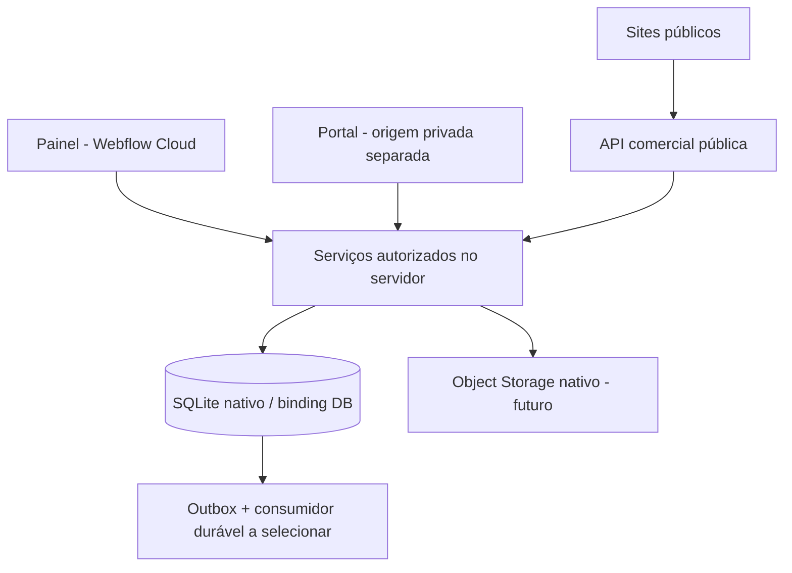

# Arquitetura atual — Webflow Cloud Apps + SQLite

O usuário confirmou duas decisões: hospedagem no Webflow Cloud Apps e tabelas no próprio ambiente Webflow. A proposta anterior de PostgreSQL/Supabase foi substituída. Os três arquivos em `docs/referencias` permanecem inalterados como fontes históricas; este documento prevalece para runtime, armazenamento e autorização.

## Stack e fontes oficiais

- Next.js/React com OpenNext para o runtime Workers do Webflow.
- **SQLite gerenciado pelo Webflow**, acessado pela API D1 via binding `DB`.
- SQL versionado manualmente em `migrations/`; um ORM não é necessário para esta primeira fatia.
- Object Storage nativo para futuros arquivos/PDFs, com autorização antes da entrega. KV poderá ser usado para caches adequados, não como livro financeiro ou fonte de revogação imediata.

Referências oficiais consultadas nesta revisão:

- [Storage nativo e bindings](https://developers.webflow.com/webflow-cloud/storing-data/overview)
- [SQLite, migrations e desenvolvimento local](https://developers.webflow.com/webflow-cloud/storing-data/sqlite)
- [Adicionar SQLite a um app](https://developers.webflow.com/webflow-cloud/add-sqlite)

Essas páginas confirmam provisionamento por `wrangler.json`, bindings por ambiente, migrations automáticas no deploy e acesso Next.js por `getCloudflareContext()`. O código inicial Next seguiu também o starter oficial `Webflow-Examples/hello-world-nextjs`, commit `c1e2207bb15071ea2673ff6e7b47d040133e1bfa`.

## Topologia

Esta base é um app na raiz do repositório, com módulos internos. Sites e portal serão separados por origem quando implementados. Rotas diferentes no mesmo host não isolam dados privados dos scripts de marketing. O app inicial não tem dados pessoais nem login.

## Modelo inicial

| Tabela | Papel |
|---|---|
| users | Identidade interna e bloqueio; autenticação/sessões ainda serão implementadas |
| organizations | Tenant e fuso de atendimento |
| memberships | Papel por organização e revogação |
| professionals | Profissional vinculado a membership da mesma organização |
| students | Cadastro mínimo de atendimento por organização |
| care_assignments | Responsabilidade técnica explícita |
| student_access | Vínculo explícito entre login e cadastro de aluno |
| app_schema_versions | Versão necessária para a prontidão do banco |

IDs são textos gerados pelo servidor (UUIDs na futura aplicação). Datas usam UTC ISO-8601; o calendário usa timezone IANA. Foreign keys compostas impedem cruzar organização, aluno e profissional. Futuros valores monetários serão inteiros em centavos e percentuais em pontos-base.

As migrations Supabase da primeira proposta nunca foram aplicadas remotamente nem publicadas e foram substituídas antes do primeiro envio da base. A partir do primeiro deploy, não editar/remover migrations aplicadas: acrescentar novas migrations.

## Autorização sem RLS

SQLite/D1 não oferece as policies RLS do PostgreSQL. O binding autoriza o **servidor do app a acessar o banco**, não autoriza automaticamente um usuário a ler alunos.

`src/db/students.ts` exige contexto de usuário/organização e restringe cada consulta por organização e vínculo ativo. Um proprietário, comercial, financeiro ou operador de suporte não recebe acesso técnico universal. As consultas reavaliam revogação e bloqueio da identidade; os valores são parâmetros SQL, não concatenação de input.

O futuro middleware/serviço de autenticação deve derivar `AuthenticatedContext` de sessão validada e organização resolvida. Nunca construir esse contexto a partir de `userId`, `organizationId`, headers livres ou JSON enviados pelo navegador. Os testes fornecem identidades controladas e ainda não comprovam login real. Não existem rotas públicas de alunos nesta fatia. O acesso bruto ao binding é privilegiado e deve permanecer em código do servidor; não há uma segunda camada RLS se um futuro desenvolvedor contornar o repository.

Use operações D1 suportadas como `batch()` para efeitos que devem ser atômicos. O teste de rollback verifica que uma falha de foreign key desfaz todo o batch. Não importar transações PostgreSQL, funções `auth.uid()`, `service_role`, extensions ou pgvector para SQLite.

## Regras de produto preservadas

- Uma identidade não une atendimentos entre organizações; cada contexto continua separado.
- Revisões entregues são imutáveis, execução aponta para revisão exata e edição humana deve ser preservada.
- Aprovação, entrega de treino, publicação de site e confirmação de pagamento são atos distintos.
- Afiliados recebem sobre pagamentos **SaaS** confirmados; receitas do profissional são outro livro.
- IA não aprova treino nem inventa evidências. Recuperação vetorial/RAG precisará de desenho compatível com o novo armazenamento; pgvector deixa de ser pressuposto.
- Origem privada sem pixels/GTM. URLs, assets, sessões e APIs terão autorização própria.

## Limites de runtime ainda relevantes

O runtime Workers não é um servidor Node permanente. Não persistir em disco de produção nem depender de promises que continuam após a resposta. Jobs/PDF devem usar execução durável cuja disponibilidade no Webflow será validada; não presumir que todo produto Cloudflare está exposto.

A montagem `basePath`/`assetPrefix` é configurada pelo builder Webflow; links usam `next/link`. Domínios compartilhados por tenants, TLS, login cross-domain, Puck e Object Storage privado ainda precisam de prova no ambiente remoto. O provisionamento nativo do DB não resolve essas fronteiras.
