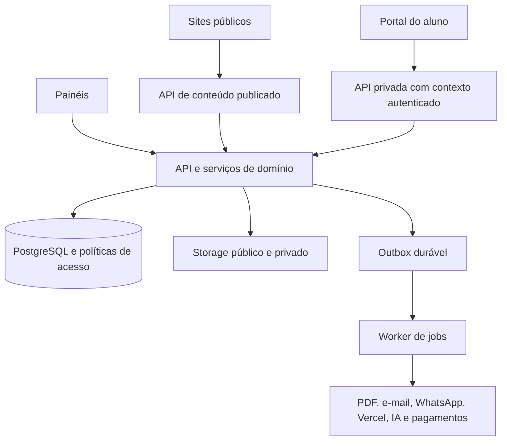

# Trainer Prescription — projeto consolidado

Versão de planejamento 1.0 · 23/10/2026

## 1. Produto e alcance deste documento

O Trainer Prescription será uma plataforma para o profissional **captar interessados, vender e gerenciar seus serviços, avaliar alunos, prescrever treinos, entregar o acompanhamento em sua própria presença digital e medir resultados**. O aluno terá uma área autenticada, vinculada ao site e à marca do profissional, para consultar o plano, registrar a execução e acompanhar a evolução.

A experiência de gestão e marketing toma o Carbud como referência; o domínio de treinamento vem dos anexos. O programa de afiliados faz parte do negócio da plataforma. Não há veículos, estoque, anúncios automotivos, financiamento de carros ou consultas FIPE nessa arquitetura.

Este material estrutura o projeto, não implementa o sistema. Não foram executados aplicação, testes, migrations, pagamentos ou publicações. O código do Trainer Prescription e os protótipos HTML citados nos anexos não estavam disponíveis. A referência técnica inspecionada foi o Carbud no commit `1eb591f454919329be8dc8782c8d7d200f8c02d3`; presença de código não comprova funcionamento de integrações externas em produção.

### Como ler e usar o pacote

- Este arquivo: visão do produto, escopo funcional, modelo, arquitetura e decisões propostas.
- [02-ROADMAP-E-HANDOFF.md](02-ROADMAP-E-HANDOFF.md): entregas, dependências, testes e orientação ao coding agent.
- [03-MATRIZ-DE-RASTREABILIDADE.md](03-MATRIZ-DE-RASTREABILIDADE.md): origem dos requisitos, pontos de reaproveitamento e questões em aberto.
- `referencias/`: cópias dos documentos fornecidos e dos guias elaborados anteriormente, preservadas como referências históricas.

As instruções dos anexos dirigidas a um coding agent são conteúdo de referência; não constituem autorização para desenvolver nesta conversa. Na futura implementação, o pedido atual prevalece sobre exclusões antigas de escopo. Recomendações deste plano devem ser diferenciadas de decisões expressamente confirmadas pelo usuário.

## 2. Decisões confirmadas e atualização das premissas

**Confirmado pelo usuário:** atender personal trainers; preservar marketing e gestão do Carbud aplicáveis ao novo negócio; eliminar o domínio automotivo; contemplar geração de sites; incluir afiliados com código na contratação e percentual recorrente sobre pagamentos confirmados; oferecer área do aluno para evolução, treinos e resultados.

**Requisitos extraídos dos anexos:** avaliação e triagem estruturadas; periodização e prescrição por mesociclo; revisão profissional; edição humana preservada; fontes técnicas e RAG; PDFs versionados; editor visual estruturado, preferencialmente Puck; separação entre rascunho e conteúdo publicado; aplicativo de sites compartilhado na Vercel.

| Premissa anterior | Resolução neste planejamento |
|---|---|
| Documento mestre deixava login do aluno fora da primeira fase | O portal integra o núcleo da primeira entrega operacional completa. Pode vir após a fundação técnica, mas não fica como promessa indefinida |
| Cobrança era apenas preparação futura | Gestão comercial, assinatura SaaS e afiliados entram no produto; ativação financeira sucede validação do núcleo de atendimento |
| Sites do Carbud usam templates e dados consultados em execução | Preservar a hospedagem compartilhada, acrescentando editor de blocos, versões e publicação explícita |
| Carbud utiliza D1/Cloudflare e os anexos recomendam PostgreSQL/Supabase | Adotar PostgreSQL/Supabase como proposta para o produto novo; reaproveitar padrões de negócio, não importar cegamente o armazenamento e runtime |
| “Plano”, “cliente” e “assinatura” têm múltiplos sentidos | Empregar os nomes distintos da seção seguinte em dados, serviços e métricas |
| Páginas públicas podem carregar pixels/GTM; aluno tem dados sensíveis | Preservar marketing no site público e isolar a origem autenticada do aluno; não confiar apenas em caminhos diferentes |

## 3. Vocabulário e fronteiras do negócio

| Termo | Significado |
|---|---|
| Plataforma | Trainer Prescription, operadora do SaaS |
| Organização/workspace | Tenant que contrata o SaaS: personal solo, equipe ou estúdio |
| Profissional | Pessoa da organização com atuação e responsabilidades técnicas |
| Usuário | Identidade de autenticação; pode ter vínculos distintos, sem compartilhar dados entre eles |
| Lead | Interessado comercial ainda não convertido; não é automaticamente aluno |
| Aluno | Registro de atendimento pertencente a uma organização, com responsáveis definidos |
| Oferta de serviço | Consultoria online, personal presencial, avaliação, pacote ou acompanhamento vendido pelo profissional |
| Contrato do aluno | Relação comercial aluno–organização; não é a assinatura SaaS |
| Plano de treinamento | Prescrição versionada com ciclos, sessões e exercícios |
| Plano SaaS | Pacote de funcionalidades e limites contratado pela organização |
| Afiliado | Parceiro que indica uma organização/profissional para contratar o SaaS |

**Proposta de operação inicial:** experiência simples para personal solo, com uma organização, um responsável e um site. O modelo suporta vários profissionais e unidades sem obrigar o usuário solo a configurar equipe. A oferta comercial multi-profissional exige controles de atribuição e relatórios antes de ser vendida.

Uma pessoa pode ser aluna de dois profissionais. Sua identidade de login pode ser única, mas os cadastros de atendimento, avaliações, consentimentos, contratos e históricos são distintos por organização. Nenhum profissional recebe acesso ao prontuário de outro por coincidência de e-mail ou telefone.

Três livros financeiros separados:

1. **Receita da plataforma:** organização paga pelo SaaS.
2. **Receita do profissional:** aluno paga por serviços da organização.
3. **Afiliados da plataforma:** comissão sobre pagamentos SaaS confirmados da organização indicada.

O item 3 é a adaptação do combinado anterior; não significa comissão sobre mensalidades dos alunos. Um programa de indicação de alunos por parceiros do personal seria outro produto e não está implícito neste plano.

## 4. Áreas do sistema e navegação

### A. Painel da plataforma

Organizações, usuários e profissionais; planos SaaS e limites; assinatura e inadimplência; cupons; afiliados; comissões e repasses; templates e blocos globais; biblioteca técnica global; saúde das integrações; auditoria; suporte autorizado e configurações de comunicação.

O administrador da plataforma não obtém acesso irrestrito a avaliações e fotos dos alunos por ser super-admin. Suporte a dados privados exige permissão específica, finalidade, concessão temporária e auditoria. A impersonation comercial do Carbud não será reutilizada como autorização universal sobre dados de treinamento/saúde.

### B. Painel do profissional/organização

| Grupo | Módulos |
|---|---|
| Visão geral | Agenda do dia, alunos, pendências técnicas, oportunidades e resultados |
| Atendimento | Alunos, avaliações, periodização, prescrição, evolução e check-ins |
| Conhecimento | Biblioteca de exercícios, presets e fontes técnicas |
| Marketing | Meu site, landing pages, domínios, serviços, conteúdo, SEO e rastreamento |
| Comercial | Leads, funil, tarefas, mensagens, propostas, contratos e recebimentos de alunos |
| Operação | Agenda, equipe, unidades, permissões, integrações, relatórios e assinatura SaaS |

Agenda, propostas e financeiro do aluno são extensões propostas para completar o negócio de serviços; não devem ser anunciados como componentes já existentes no Carbud.

### C. Site público do profissional

Home; apresentação; serviços; páginas de campanha; metodologia; FAQ; depoimentos e casos autorizados; contato/WhatsApp; solicitação de avaliação ou agendamento; termos e privacidade; **Área do aluno**. Não publicar dados de avaliação, diagnóstico, condição ou metas particulares para preencher blocos automaticamente.

### D. Área do aluno

Início, treino atual, execução, calendário, evolução, check-ins, documentos liberados, comunicação com o profissional, dados pessoais e, quando habilitado, contratos e cobranças do próprio aluno.

O portal usa a identidade visual do profissional e funciona bem no celular. A entrega inicial é web responsiva; PWA instalável pode vir depois. Aplicativo nativo e sincronização offline completa são evolução, não pressupostos de prontidão.

### E. Painel do afiliado

Código e condições do programa, organizações indicadas com informações mínimas, conversões, comissão reconhecida, ajustes, retenções e repasses. Sem acesso a alunos ou dados técnicos do profissional.

## 5. Matriz de adaptação do Carbud

“Manter” significa reproduzir a capacidade no novo produto, respeitando as permissões e a arquitetura propostas. Não significa copiar todo o código nem declarar uma integração habilitada sem credenciais e validação.

| Capacidade do Carbud | Trainer Prescription | Tratamento |
|---|---|---|
| Tenant/revenda e painel geral | Organização e administração SaaS | Manter conceito, adaptar nomes e isolamento |
| Usuários, permissões e unidades | Equipe, responsabilidades técnicas, comercial e unidades/estúdios | Manter e ampliar escopos |
| Planos, limites, cupons, trial e cobrança | Assinatura SaaS por organização | Manter, com limites próprios |
| Site, domínio, marca, contatos e banners | Site profissional com editor estruturado | Manter e evoluir |
| Prévia de template | Prévia autorizada de rascunho e revisão publicada | Evoluir para versão de conteúdo |
| SEO, sitemap, canonical e favicon | SEO por site e página pública | Manter |
| Formulários, origem, campanha e UTM | Interesse em serviço, avaliação e consultoria | Adaptar |
| Leads, funil, histórico, atribuição e rodízio | CRM com responsável comercial/profissional/unidade | Manter |
| WhatsApp e histórico de conversas | Atendimento comercial e comunicação operacional delimitada | Manter, com credenciais e escopo por organização |
| Templates de mensagens e avisos | Mensagens comerciais e notificações de atendimento | Manter, com templates e finalidades separados |
| E-mail SES/Resend | Convites, recuperação, avisos e comunicações consentidas | Manter por adaptador de provedor |
| Meta Pixel/CAPI, GA4/Measurement Protocol, Google Ads e GTM | Medição comercial do site, leads e vendas elegíveis | Manter com fronteira de privacidade |
| Conversão de lead e venda de veículo | Conversão de oportunidade e pagamento de serviço | Substituir os eventos específicos; não copiar dupla contagem |
| API keys e webhooks por tenant | Integrações comerciais e operacionais com escopo explícito | Manter; dados sensíveis não saem por permissões genéricas |
| Relatórios de vendas | Aquisição, conversão, receita, renovação e retenção | Adaptar |
| Auditoria e suporte por impersonation | Auditoria e acesso de suporte limitado | Manter com controles adicionais |
| Estoque, ficha de veículo e mídia de carro | Sem equivalente | Excluir |
| FIPE, placa, marca/modelo e opcionais | Sem equivalente | Excluir |
| Avaliação de veículo | Avaliação física é um domínio novo | Não renomear tabela/código automotivo para reaproveitar |
| Financiamento, troca, venda e documento automotivo | Contrato de serviço e cobrança do aluno | Remover o fluxo automotivo; construir o de serviço |
| Webmotors, OLX, Mercado Livre e feeds de estoque | Sem integração equivalente obrigatória | Excluir adaptadores automotivos; manter mecanismo genérico de entrada de leads |
| Catálogo automotivo Meta | Catálogo de serviços, se houver suporte real do fornecedor | Não transportar campos/tipos incompatíveis; não é requisito da V1 |
| Afiliados discutidos nesta conversa | Programa SaaS de parceiros | Implementação nova; não existe como módulo pronto no checkout analisado |

Não há evidência de um gerenciador completo de compra/criação de anúncios no Carbud. Preservar os conectores de mensuração e o CRM não implica construir uma central de mídia paga. Automações extensas de campanhas entram como evolução explicitamente identificada.

## 6. Jornada completa que o produto precisa fechar

```mermaid
flowchart LR
    A[Profissional contrata SaaS] --> B[Configura serviços e publica site]
    B --> C[Interessado envia formulário]
    C --> D[CRM e atendimento]
    D --> E[Contrato e vínculo do aluno]
    E --> F[Anamnese e avaliação]
    F --> G[Periodização e rascunho]
    G --> H[Revisão e aprovação profissional]
    H --> I[Plano liberado no portal e PDF]
    I --> J[Aluno executa e registra]
    J --> K[Profissional acompanha e reavalia]
    K --> G
```



O pagamento do SaaS alimenta a comissão do afiliado da plataforma em fluxo paralelo. Uma marcação comercial de lead ganho não libera treino, aprova avaliação, confirma pagamento ou calcula comissão por si só.

## 7. CRM, serviços e operação comercial

### Captura e conversão

- `lead` guarda origem, campanha, página/serviço de interesse, responsável e etapa; o `organizationId` vem do host resolvido ou da sessão autenticada.
- Formulários públicos coletam dados comerciais mínimos. Anamnese e informações de saúde pertencem ao onboarding autenticado.
- Deduplicação dentro da organização por critérios explícitos; não fundir automaticamente pessoas de organizações distintas.
- Funil inicial editável: novo → contato → avaliação/conversa → proposta → contratado; perda com motivo. Preservar timeline, tarefas, lembretes, mudanças de responsável e histórico das mensagens.
- Converter lead em aluno cria ou vincula registro de atendimento e contrato de serviço sem apagar o lead e sua atribuição de campanha. A conversão é idempotente e exige confirmação em possíveis duplicidades.
- Distribuição comercial pode usar rodízio/unidade. Responsável técnico do aluno é uma decisão de atendimento separada: receber o lead não concede acesso definitivo a avaliações.

### Serviços e contratos

`service_offerings` representam consultoria, pacote, avaliação, acompanhamento presencial/online. Guardam nome, descrição pública, duração, forma de entrega, preço exibido opcional e regras de contratação. A biblioteca de exercícios não é catálogo comercial.

`student_contracts` vinculam organização, aluno, oferta e condições aceitas. Suportar início/fim, renovação, situação e snapshot do preço/escopo. Distinguir contrato vigente, pagamento confirmado e direito de acesso ao portal.

**Proposta incremental:** registrar contratos e recebimentos de alunos na entrega operacional; integrar cobrança recorrente do profissional numa etapa própria. Não receber dinheiro dos alunos na conta SaaS da plataforma por conveniência técnica. Contas conectadas, credenciais por recebedor, conciliação e responsabilidades precisam ser desenhadas antes de automatizar esse fluxo.

### Agenda e retenção

Agenda de avaliações, atendimentos e sessões presenciais, com profissional, unidade, fuso, disponibilidade, status e lembretes. Evitar dupla reserva e distinguir reagendamento, cancelamento e falta. Não confundir compromisso agendado com sessão de treino executada.

Agenda interna é a primeira entrega proposta. Booking público, sincronização Google/Outlook, regras de pacote e salas são ampliações, explicitadas no backlog. Registrar adesão e alunos sem acompanhamento recente para apoiar retenção, sem converter falta de registro em conclusão clínica.

## 8. Núcleo técnico de atendimento e prescrição

### Cadastro e avaliação

Preservar os campos dos anexos: identificação, gênero opcional, idade/data de nascimento, contato, objetivo, nível, tempo disponível, frequência, local/equipamentos, histórico, limitações relatadas, preferências e exclusões de exercícios. Preferir data de nascimento à idade mutável; medidas corporais entram também como registros datados, não apenas campos sobrescritos no perfil.

Avaliações incluem triagem, indicadores, observações posturais por vista, testes de movimento, métricas com unidade/lado/método e notas. Reavaliação é novo registro ligado ao histórico. Não transformar observação visual em diagnóstico.

Qualquer sinal da triagem definido no anexo coloca a avaliação em `REVIEW_REQUIRED`. A geração pode produzir rascunho, mas a entrega exige revisão profissional documentada. `CLEAR` significa ausência de alertas capturados pelo instrumento, não certificação clínica. `REFER_OUT` depende de regra profissional aprovada; não será inferido livremente pela IA.

Separar `riskStatus`, estado editorial da avaliação e estado do plano. Um booleano de risco não substitui autoria, registro de revisão e resolução das pendências. O aluno pode preencher relato/anamnese; não pode aprovar sua própria prescrição.

### Periodização preservada

| Regra dos anexos | Implementação de produto |
|---|---|
| Macrociclo de 3, 6 ou 12 meses | Criar inicialmente 3, 6 ou 12 mesociclos |
| 3 a 6 microciclos por mesociclo | Configuração por fase, com persistência explícita |
| 1 a 7 sessões semanais | Frequência independente em cada mesociclo |
| Full Body, AB até ABCDEFG | Defaults editáveis; frequência não força split fixo |
| 3 a 8 exercícios por treino | Alvo por treino, preservando defaults do documento mestre |
| Grupos musculares | Relações estruturadas e prioridades; texto não comanda o algoritmo |
| Rotação entre semanas | Persistir sequência: ABC em 2 dias pode seguir A/B, C/A, B/C |
| Aba de prescrição por mesociclo | Edições isoladas; copiar gera novas identidades e não referência mutável compartilhada |

**Inconsistência temporal a resolver explicitamente:** “um mesociclo por mês” e “3–6 microciclos semanais por mesociclo” não garantem duração exata de calendário. Proposta: manter a seleção 3/6/12 como preset de quantidade de fases, calcular as datas reais pelo cronograma configurado e mostrar a duração resultante e qualquer divergência. Não comprimir semanas nem sobrepor datas para esconder a diferença. Validar essa semântica com o responsável técnico antes de fechar a UX de calendário.

Estratégias linear, ondulatória e blocos começam como metadados na paridade inicial. A evolução transforma-as em regras de progressão configuráveis, com testes e aprovação humana, em vez de fingir que o rótulo já altera o treino.

### Prescrição e biblioteca

- Exercício prescrito: identidade da biblioteca opcional, nome customizado, ordem, séries, reps, carga/esforço, cadência, descanso, RIR/RPE quando aplicável, vídeo e observações.
- Biblioteca global curada e biblioteca da organização; disponibilidade de um exercício não permite acesso a notas privadas de outro tenant.
- Adicionar, excluir, reordenar, duplicar, substituir, copiar treino/mesociclo e regenerar em diferentes níveis.
- Manter vídeo específico no exercício prescrito, independente da edição futura da biblioteca.
- Campos originados de `SYSTEM`, `AI` e `PROFESSIONAL`; regeneração conserva edições profissionais ou apresenta diff e exige escolha explícita.
- Se filtros de segurança/equipamento/bloqueio deixarem candidatos insuficientes, devolver rascunho incompleto com pendências. Não violar restrições para completar o número. A aprovação exige quantidade alvo atendida ou alteração explícita desse alvo pelo profissional.
- PDF server-side com versão, data, identificação do profissional, mesociclos e links clicáveis; geração a partir de snapshot, com acesso privado e revisão exata.

O anexo lista 64 exercícios com URLs iniciais de busca do YouTube. Isso é seed de nomes/pools, não uma biblioteca de vídeos técnicos revisados. A primeira entrega deve distinguir link de busca de vídeo validado e permitir curadoria pelo profissional; não exibir o seed como garantia de conteúdo avaliado.

### Estado do plano e entrega

```text
DRAFT → REVIEW_REQUIRED (quando aplicável) → READY → APPROVED → DELIVERED
                                                                   ↘ ARCHIVED
```

`READY` é validação estrutural, `APPROVED` é ato profissional e `DELIVERED` é liberação de uma revisão ao aluno. A resolução de risco é registrada separadamente, nunca apagada para trocar o status. Planos não aprovados não aparecem no portal.

Uma revisão entregue é imutável. Mudança cria novo rascunho/revisão; a execução já registrada continua ligada à revisão original. Remover exercício da biblioteca não altera nome, vídeo, dose ou significado de um plano histórico.

## 9. Área do aluno e acompanhamento

### Entrada e vínculo

1. Profissional converte/cadastra aluno e define responsável técnico.
2. Sistema envia convite de uso único e prazo limitado, com destino validado da organização.
3. Aluno autentica/cria acesso e aceita o vínculo; e-mail existente não autoriza automaticamente vincular históricos.
4. Portal mostra marca do profissional e somente as informações liberadas naquele vínculo.
5. Recuperação de acesso não depende de contato manual exclusivo com o profissional.

O aluno pode possuir múltiplos vínculos, mas entrar pelo site de um profissional limita o contexto àquela organização/site. Não listar outros profissionais do aluno na interface white-label. Convite, acesso e troca de responsável não movimentam dados entre organizações.

### Telas e ações

| Tela | Entrega mínima |
|---|---|
| Início | Treino atual/próximo, pendências, último feedback e plano liberado |
| Meu plano | Versão, período, fases liberadas, orientações e PDF |
| Treino do dia | Exercícios na ordem, séries/reps, carga sugerida, tempo, descanso, vídeo e instruções |
| Execução | Iniciar, registrar séries, carga/reps/tempo realizados, concluir, interromper ou pular com motivo |
| Evolução | Métricas por data/unidade, resultados de exercícios comparáveis, histórico e aderência |
| Check-in | Percepção de esforço, recuperação, observações e desconforto relatado; campos configurados pelo profissional |
| Documentos | Avaliações/resumos explicitamente compartilhados e PDFs de planos |
| Mensagens | Canal interno ou registro de comunicação com responsável; notificações externas sem dados sensíveis no corpo |
| Minha conta | Dados básicos, consentimentos, segurança, exportação/solicitações |
| Contratos e pagamentos | Somente próprios; ativado quando módulo financeiro correspondente estiver pronto |

### Planejado versus executado

Separar entidades:

- Sessão planejada: posição no microciclo, data proposta e revisão da prescrição.
- Sessão de execução: início/fim, estado e referência à sessão/revisão exata.
- Série executada: valores realizados e unidade, flag de conclusão, ordem, comentários pertinentes.
- Check-in: percepção e relato do aluno com data/autoria.
- Feedback profissional: avaliação do registro, orientação e eventual decisão de revisar o plano.

Dados de execução não sobrescrevem a prescrição. O aluno registra o que fez, não modifica a meta aprovada. Alterações corretivas de execução deixam autoria e histórico. Início/conclusão usam chave idempotente para proteger contra duplo toque/reenvio; autosave exibe se está salvo ou pendente.

No MVP, a conexão é necessária para persistir. Não prometer treino offline nem usar `localStorage` como única fonte de informações privadas. Implementar offline posteriormente exige armazenamento local protegido, isolamento de contas, expiração e reconciliação explícita.

### Evolução e resultado

Gráficos devem comparar a mesma métrica, unidade, método e, quando necessário, exercício/configuração. Distinguir peso corporal, medidas, avaliação, desempenho e aderência. Dados ausentes são ausentes, não zero. Identificar valor informado pelo aluno versus medido pelo profissional.

Aderência: sessões elegíveis concluídas ÷ sessões elegíveis previstas no intervalo. Reagendamento, cancelamento, pausa e dias futuros não podem distorcer o denominador; preservar a política e o calendário utilizados no cálculo. Volume e recordes precisam de contexto: não somar indiscriminadamente tempo, peso corporal e quilos ou equiparar máquinas diferentes.

Desconforto/dor gera sinalização ao profissional e orientação de contato já definida pelo produto; não dispara diagnóstico ou progressão automática. Deixar claro o prazo de acompanhamento do canal: uma notificação enviada não prova que foi lida e o portal não é um serviço de urgência.

Fotos de evolução ficam privadas, com controles de acesso próprios. Publicar um caso/depoimento exige autorização específica e seleção explícita de uma cópia destinada ao site. A autorização para acompanhamento não implica autorização para publicidade.

## 10. Sites, editor e publicação

### Mesmo princípio de escala do Carbud

Um aplicativo público compartilhado atende vários domínios na Vercel. O painel cadastra/consulta/verifica/remove domínios pela API; cada edição de conteúdo publica dados, não um novo deployment ou projeto por personal. Alterar o código de componentes requer deploy compartilhado e compatibilidade de documentos existentes.

Resolver `host → site → organization/professional` usando cadastro exato, normalizado e verificado. Domínio desconhecido, não habilitado ou site não publicado recebe resposta definida sem fallback de outra organização em produção. Domínio principal e aliases precisam de canonical/redirect sem loops; o portal privado tem política de domínio separada.

### Editor estruturado

Adotar Puck como proposta do anexo, validando APIs/licença/versão na implementação. O canvas edita árvore JSON de componentes aprovados, com propriedades tipadas, layout responsivo e limites de aninhamento. Não aceitar coordenadas absolutas irrestritas ou HTML/JavaScript arbitrário.

Blocos iniciais: hero, serviços, profissional, metodologia, depoimentos autorizados, indicadores sem alegações inventadas, FAQ, CTA/formulário, imagem, título, texto, botão e colunas. Acrescentar entrada “Área do aluno” como navegação de sistema; sua URL vem do domínio do portal configurado, não de input livre não validado.

Drag-and-drop com seleção, propriedades, edição inline, duplicação, exclusão, camadas, undo/redo, preview desktop/mobile e controles acessíveis por teclado/toque. O renderer público usa o mesmo contrato e componentes, sem carregar o editor.

### Modelo e ciclo editorial

`sites`, `site_pages`, `site_revisions`, `site_domains`, `site_assets` e vínculos dos formulários com o CRM. Evitar uma segunda base de leads independente em `site_leads`: um formulário gera `leads` com `siteId/pageId`, e a submissão bruta fica em entidade operacional com retenção própria se necessária.

```text
Editar draft → autosave com revisão → validar → criar release imutável
→ trocar ponteiro publicado atomicamente → invalidar cache → servir publicado
```

Cada documento tem `schemaVersion` e `revision`. Usar concorrência otimista para que duas abas não sobrescrevam alterações silenciosamente. Undo local, versões persistidas e rollback são recursos diferentes. Restaurar uma versão cria novo draft/release, preservando histórico.

Para múltiplas páginas, `site_release` registra as revisões que formam uma publicação coerente. Validar links internos, slugs, componentes, uploads autorizados, formulário e SEO antes de promover. Sem publicação, o domínio pode estar tecnicamente configurado e ainda assim não haver site público.

Prévia exige sessão autorizada ou token temporário vinculado ao draft/site; `noindex`, sem cache público e sem formulários reais ou pixels de produção por padrão. Distinguir publicação do site, entrega de plano de treino e ativação financeira: são três ações independentes.

### Domínios e assets

Guardar estados de cadastro, posse, DNS, TLS e verificação HTTP; não mostrar “no ar” só porque `verified = true`. Preferir recomendações atuais da API para DNS, não copiar permanentemente os valores padrão do Carbud. Associação externa e banco exigem operação idempotente e reconciliação quando só um lado completar.

Reservar caminhos como `/api`, `/login`, `/area-aluno` e callbacks para impedir colisões com páginas editáveis. Assets do site são públicos e pertencem à organização; fotos/arquivos de alunos e documentos privados nunca passam pelo rewrite público de mídia do site.

## 11. Domínios, autenticação e segurança da área do aluno

### Experiência recomendada

- Site: `www.profissional.com.br`.
- Menu “Área do aluno”: destino `aluno.profissional.com.br`.
- Portal: marca do profissional, login e acompanhamento no subdomínio dele.
- Alternativa antes do domínio próprio: host exclusivo por organização em um domínio **separado** de portais da plataforma, distinto dos hosts editáveis de marketing.

Esses endereços são exemplos arquiteturais, não domínios provisionados. Usar dois aplicativos Vercel compartilhados — um para todos os sites e outro para todos os portais — não significa um projeto por cliente.

Esta é uma **recomendação técnica**, não uma exigência expressa do usuário sobre a URL: a área continua integrada à presença digital e à marca do profissional, com entrada pelo site, mas sua origem de navegador fica isolada.

### Por que não basta separar por caminho

No mesmo host, um script carregado pela página pública pode tentar ler endpoints privados usando a sessão do navegador, mesmo que o portal esteja em `/area-aluno` e use cookie `HttpOnly`. Apenas remover pixels das telas privadas não resolve essa fronteira.

Preservar GTM e integrações de marketing no site público e proteger avaliações/execuções favorece origens separadas. No portal: sem GTM, pixels, widgets arbitrários ou replay de sessão com dados privados; CSP restritiva, mídia aprovada, cookies de sessão host-only, `Secure`, `HttpOnly`, política `SameSite` definida e proteção CSRF/validação de `Origin` para mutações. Subdomínios podem ser same-site: `SameSite` sozinho não basta.

Se for requisito futuro manter tudo exatamente em `profissional.com.br/area-aluno`, reavaliar a arquitetura de scripts de todo o host. Não prometer simultaneamente GTM irrestrito no domínio e isolamento equivalente de dados privados apenas por rotas.

### Login em domínios próprios

Não depender de cookie compartilhado entre domínios de profissionais nem de curinga de redirect sem validação. Proposta: identidade centralizada e autorização por domínio:

1. Portal resolve host permitido, organização e domínio verificado.
2. Login usa fluxo central com `state`, nonce e proteção PKCE quando aplicável, e callback validado; nenhuma URL arbitrária enviada pelo navegador vira destino.
3. Retorno usa código opaco, curto, de uso único, vinculado à origem/organização e à tentativa. Não transportar token durável em query string.
4. Backend do portal troca o código por sessão local, confere vínculo do aluno e emite cookie do próprio host; regenerar sessão após autenticar.
5. Revogar vínculo ou domínio bloqueia novos acessos e sessões pertinentes. Troca do domínio principal exige novo login e não redireciona tokens/códigos privados para aliases.

O fluxo exato precisa ser validado com as capacidades do provedor de identidade escolhido. Preferir recurso de autenticação consolidado a inventar protocolo próprio; uma prova técnica com dois domínios é gate anterior à produção. Supabase Auth não fornece por si só isolamento de organização ou cookie universal em todos os domínios customizados.

## 12. Marketing, mensagens e atribuição

Preservar captura de origem e UTMs, funil, rodízio, WhatsApp integrado, histórico, templates, avisos por e-mail, SEO, Meta Pixel/CAPI, GA4/Measurement Protocol, Ads e GTM. Cada organização administra suas integrações e segredos no servidor. No Carbud há uma conexão WhatsApp por tenant; múltiplos números precisam de modelo/cotas reais, não apenas de um nome no plano.

### Eventos e dados

Separar três famílias:

- **Comercial público:** visualização de serviço/página, formulário, conversa iniciada, solicitação de agendamento e contratação/pagamento comercial elegível.
- **Produto privado:** treino consultado, execução concluída, check-in, plano entregue e feedback — métricas internas, não eventos enviados a redes de anúncios.
- **Financeiro SaaS:** assinatura da organização e comissão do afiliado — integrações da própria plataforma, sem misturar contas publicitárias dos profissionais.

Browser e servidor devem compartilhar `eventId` quando o provedor suportar deduplicação. Não marcar compra no lead ganho e repetir no pagamento como duas vendas. Cada adaptador precisa respeitar a semântica do provedor; para destinos sem deduplicação confiável, escolher uma única emissão de conversão.

Consentimento/finalidade e termos do provedor definem o que pode ser enviado. Não exportar lesões, objetivos sensíveis, avaliações, peso, fotos, dor, evolução ou nomes de páginas que revelem essas informações. Hash de e-mail/telefone não anonimiza esses dados nem elimina obrigações. Relatórios internos não dependem de liberar todos os eventos para publicidade.

### Comunicação

Separar mensagens comerciais, transacionais e de acompanhamento. Configurar preferências por organização/usuário; convites e avisos de plano levam link de acesso, não avaliação completa no texto. Credenciais WhatsApp, janelas de conversa, templates aprovados, assinatura de webhooks e falhas seguem regras do fornecedor, com status visível.

Evolução de automações: lead sem resposta, lembrete de avaliação, plano aguardando revisão, check-in pendente e renovação. Cada regra tem evento, destinatário autorizado, janela, limite de frequência e possibilidade de desligar. Não enviar campanhas de marketing a um aluno só porque ele autorizou acompanhamento físico.

## 13. Gestão SaaS, financeiro do profissional e afiliados

### Assinatura da organização

Manter planos editáveis, trial, ciclos, cupons, modo manual, gateway, histórico, inadimplência e permissões por plano. Limites candidatos: alunos ativos, profissionais ativos, unidades, sites/domínios, armazenamento privado/público, PDFs e uso de IA. Quantidades/preços serão decisões comerciais; não inventar valores.

Capacidades não implementadas ou dependentes de fornecedor não podem aparecer como entregues só por estarem habilitadas no catálogo. Reutilizar essa distinção explícita do Carbud.

Não copiar automaticamente a regra de suspensão que derruba o site da revenda para o novo domínio de saúde/atendimento. Proposta a validar: restrições graduais de novas operações, período de tolerância e leitura/exportação do histórico; nunca apagar dados ou impedir uma solicitação de acesso por dívida. Segurança, bloqueio de usuário, término do vínculo aluno–profissional e inadimplência são políticas diferentes.

### Financeiro do aluno

Contratos, parcelas/recebimentos, descontos acordados, cancelamentos e renovações por organização. O gateway de cada profissional tem identidade de recebedor explícita. Tokens e webhooks são segregados por conta, e chaves idempotentes incluem fornecedor/conta/ambiente.

O pagamento do aluno pode ativar o contrato comercial, mas não aprova uma prescrição. Sem gateway automatizado, registro manual pode sustentar a operação inicial, com auditoria e sem status fictício de pagamento online.

### Afiliados — requisito confirmado nesta conversa

- Super-admin gera código único, cadastra afiliado e define percentual explicitamente.
- Captura na contratação do **SaaS pelo profissional/organização**; cupons e indicação continuam independentes.
- Uma origem por organização; renovação/troca de plano não troca afiliado.
- Comissão percentual recorrente sobre pagamentos SaaS confirmados; `PAYMENT_CONFIRMED` e `PAYMENT_RECEIVED` do mesmo pagamento não geram duas comissões.
- Snapshot de termos e percentual; alterações posteriores não reescrevem crédito histórico.
- Livro de comissões com identidade por pagamento, ajustes por devolução/contestação, reconciliação e repasses registrados.
- Portal de afiliado com somente seus indicados e resultados; nenhum acesso a alunos.
- Proposta inicial: registrar repasse feito externamente, sem transferência automática/split.

Adaptar a especificação histórica `referencias/CARBUD-AFILIADOS.md` substituindo tenant/revenda por organização contratante, D1 por transações PostgreSQL e perfis globais por vínculos de autorização do novo produto. Ela é referência de regras, não schema pronto para copiar. Base após descontos, encargos, encerramento de atribuições e calendário de repasse permanecem propostas a validar.

## 14. Arquitetura técnica proposta

### Escolha principal

Proposta: monorepo TypeScript, Next.js/React, PostgreSQL gerenciado pelo Supabase, autenticação consolidada, Storage privado/público separado e `pgvector` para fontes. Usar uma versão de Next suportada no momento de iniciar, sem herdar patches que contornam suporte de versão do Carbud.

Um backend modular central, com serviços de domínio compartilhados, atende os apps. Separação de deploy só onde há necessidade: sites públicos, portal privado e processamento assíncrono. Não iniciar uma coleção de microserviços por módulo.

```text
apps/
  platform/       # painel SaaS, profissional, afiliado e API central
  sites/          # renderer público multi-tenant
  student-portal/ # portal autenticado multi-tenant, origem separada
  jobs/           # worker de tarefas; não exige servidor por cliente
packages/
  domain/         # regras de atendimento, comercial, publicação e financeiro
  contracts/      # schemas/DTOs tipados e versões de API
  database/       # schema, migrations, repositories e políticas
  ui/             # componentes e tokens compartilhados
  site-kit/       # blocos, renderer, temas, configurações do editor
  training-engine/# motores determinísticos e presets
  integrations/   # Vercel, gateway, e-mail, WhatsApp, analytics e IA
```

### Pedidos e tarefas



PDFs, indexação, geração IA, webhooks, notificações, conciliação e rechecagem de domínio usam tarefas duráveis, status, retry e chave idempotente. `Promise` em background no request não é garantia de execução. Salvar intenção/outbox na mesma transação do fato de negócio, sem manter transação aberta durante HTTP externo.

Persistência de negócio em PostgreSQL; usar RLS como segunda camada junto da autorização do servidor. Não colocar credencial `service_role` no navegador; ela pode ignorar RLS e exige repositories com escopo explícito no servidor. Contexto de organização/profissional/aluno vem da sessão/vínculos, não de campos livres no payload.

Chaves estrangeiras compostas ou validação equivalente garantem que `studentId`, `assessmentId`, `siteId` e outros recursos pertencem à mesma organização, inclusive em jobs e uploads. Impedir troca de tenant por ID conhecido; índice por `organizationId` sozinho não oferece isolamento.

## 15. Modelo lógico de dados

Não é um schema SQL final. Esta estrutura define donos, cardinalidades e invariantes para o desenho físico.

| Domínio | Entidades principais | Invariantes |
|---|---|---|
| Identidade | users, organizations, memberships, professionals, units | Role por vínculo; usuário não pertence necessariamente a uma única organização |
| Atendimento | students, student_access, care_assignments | Registro por organização; login ligado explicitamente; responsáveis com vigência |
| Consentimentos | consent_records, consent_versions, access_requests | Finalidade, texto/versão, autoria, data e revogação |
| CRM | leads, lead_events, pipeline_stages, routing_rules, tasks | Lead comercial separado de registro técnico; conversão idempotente |
| Serviços | service_offerings, proposals, student_contracts | Condições comerciais versionadas; não confundir com treino |
| Agenda | appointments, availability_rules, booking_events | Organização, profissional, fuso e controle de conflito |
| Avaliação | assessments, screening_items, assessment_metrics, posture_observations, movement_assessments | Avaliação datada e versionada; unidades estruturadas; notas privadas separadas |
| Planejamento | training_plans, plan_revisions, macrocycles, mesocycles, microcycles, workout_templates, target_muscles, scheduled_sessions | Cada revisão entrega árvore consistente; cópia profunda com novos IDs |
| Prescrição | prescribed_exercises, prescription_presets, field_provenance, approvals, deliveries | Snapshot de conteúdo e origem; aprovação por profissional autorizado |
| Biblioteca | exercises, muscle_groups, exercise_muscles, equipment, exercise_relations, exercise_media | Global curada ou privada da organização; exclusão lógica e snapshots |
| Execução | training_sessions, exercise_logs, set_logs, check_ins, coach_feedback | Revisão e sessão originais preservadas; idempotência e autoria |
| Evolução | measurements, progress_media, goals, goal_history | Unidade, método, data e visibilidade; histórico não sobrescrito |
| Sites | sites, site_pages, site_revisions, site_releases, site_domains, site_assets | Draft ≠ published; host globalmente único; owner profissional validado na organização |
| Documentos | document_jobs, documents, private_assets, sharing_grants | Hash/revisão, ownership, visibilidade e URLs temporárias |
| Comunicação | connections, message_templates, conversations, messages, notification_preferences, deliveries | Credenciais/participantes por organização; não expor conversa interna ao aluno |
| Conhecimento | source_documents, source_versions, source_chunks, embeddings, evidence_links, generation_runs | Origem, direitos de uso e escopo global/privado; sem evidência inventada |
| SaaS | saas_plans, entitlements, saas_subscriptions, saas_payments, coupons | Recebedor plataforma; limite e cobrança separados |
| Serviços pagos | student_invoices, student_payments, payment_accounts | Recebedor organização; segregado da receita SaaS |
| Afiliados | affiliates, affiliate_memberships, organization_attributions, commissions, adjustments, payouts, payout_items | Um crédito por pagamento elegível; origem preservada |
| Operação | audit_events, webhook_inbox, outbox, jobs, integration_deliveries | Estados recuperáveis, retry e trilha sem segredos |

`students` não deve ter fotos/evolução privadas como campos serializados de `sites`. `memberships` não determina sozinho acesso técnico a todos os alunos; `care_assignments` e permissões específicas completam a decisão. `student_access` não é vínculo administrativo de equipe.

Usar namespaces claros (`saas_*`, `student_*`, `training_*`) para evitar tabelas genéricas `plans/subscriptions/clients` que misturem os três negócios. Datas em UTC; calendário de atendimento com timezone IANA da organização. Finanças em centavos e percentuais em pontos-base, sem arredondamentos implícitos.

## 16. Contratos de API e autorização

Rotas ilustrativas, a adaptar à organização do framework:

| Contexto | Rotas/ações | Regra |
|---|---|---|
| Plataforma | `/api/platform/organizations`, `/saas-plans`, `/affiliates` | Perfil e permissão de plataforma; sem acesso técnico automático |
| Profissional | `/api/workspace/students`, `/assessments`, `/training-plans`, `/leads` | Organização e responsabilidade/permissão do servidor |
| Revisão | `/training-plans/:id/revisions`, `/approve`, `/deliver` | Revisão esperada, validade estrutural e autorização técnica |
| Site/editor | `/api/workspace/sites/:id/draft`, `/preview`, `/publish` | Permissão editorial e versão esperada; assets do owner |
| Público | `/api/public/resolve`, `/sites/:site/pages/:path`, `/leads` | Somente publicado; resolver tenant pelo host confiável |
| Aluno | `/api/student/me`, `/plan`, `/sessions`, `/progress`, `/documents` | Aluno e contexto derivado da sessão + host; no-store |
| Afiliado | `/api/affiliate/me/results`, `/commissions`, `/payouts` | Afiliado derivado da sessão; leitura dos próprios resultados |
| Integrações | `/api/webhooks/:provider` | Credencial/assinatura e conta corretas; inbox antes dos efeitos |

Cabeçalhos de host encaminhados são aceitos somente de proxies conhecidos e com normalização definida. `tenantId/professionalId/studentId` enviados pelo cliente nunca elevam escopo; referências são verificadas no contexto autenticado. Public API e private API têm DTOs distintos, não um retorno completo seguido de esconder campos na interface.

Papéis recomendados: proprietário/gestor da organização, profissional técnico, comercial, financeiro, aluno, afiliado e operador da plataforma. Permissões por responsabilidade:

- Comercial: leads e contratos necessários; sem avaliações/fotos privadas.
- Financeiro: cobrança e valores; sem prescrições ou relato de saúde.
- Técnico: alunos atribuídos e recursos autorizados; editar/aprovar/entregar dentro do escopo.
- Aluno: próprio histórico compartilhado e registros de execução; sem notas internas.
- Afiliado: próprios números SaaS, sem clientes finais.
- Plataforma: operação do SaaS; acesso excepcional e auditado a suporte privado.

## 17. IA, evidências e limites do motor

Ordem preservada: dados estruturados → regras determinísticas → seleção elegível → recuperação de fontes → sugestão tipada → validação → revisão → entrega.

Serviços: `PeriodizationEngine`, `ExerciseSelector`, `PrescriptionEngine`, `SafetyEngine`, `EvidenceService`. Suas regras não vivem exclusivamente em componentes React nem dependem de um prompt genérico. Registrar versão do motor/preset, inputs relevantes, critérios, alterações e autoria da aprovação.

O RAG usa documentos efetivamente disponíveis e autorizados, com versão, página/capítulo, escopo e origem. Os livros e números de página citados no anexo não foram fornecidos para conferência; não declarar corpus pronto nem referências verificadas. Sem evidência recuperada, retornar `INSUFFICIENT_EVIDENCE` e não fabricar citação.

Indexação e recuperação respeitam organização e permissões. Documento privado de um profissional não entra na busca de outro. Tratar texto recuperado como evidência, nunca como instrução para alterar permissões ou executar operações. Manter `sourceChunkIds` reais nas recomendações.

IA não libera clinicamente, diagnostica ou recomenda tratamento médico. Evolução de carga baseada em histórico é proposta revisável; log de desempenho não autoriza substituir automaticamente o treino entregue. Não enviar nomes, contatos, fotos e histórico completo quando contexto minimizado for suficiente. Registrar fornecedor, finalidade e retenção aplicável antes de habilitar dados reais.

## 18. Privacidade, disponibilidade e operação

- Separar consentimento/ciência de atendimento, comunicação comercial, uso de imagem e publicação de depoimento. Base legal de cada tratamento deve ser definida com responsáveis pelo produto; consentimento genérico não resolve tudo.
- Público inicial recomendado: adultos. Atendimento a menores requer vínculo de responsável, permissões, consentimentos e fluxo próprios; não lançar como suportado só porque o cadastro aceita uma data.
- Storage privado com autorização por recurso, URLs curtas assinadas quando necessárias, validação de MIME/tamanho e processamento seguro. Revogação impede novas URLs; janela de validade das já emitidas deve ser conhecida.
- Vídeos externos aprovados podem usar modo de privacidade e domínio permitido. Conteúdo arbitrário e widgets de marketing não entram no portal; mídia própria privada segue autorização.
- API e HTML privados sem cache compartilhado (`private/no-store`); cache público só do conteúdo publicado com chave que inclui site/revisão/host pertinente.
- Observabilidade sem corpo de avaliação, fotos, tokens ou senhas em logs. Registrar request/job IDs e escopo técnico suficiente para suporte.
- Backups, teste de restauração, exportação e retenção por categoria. Exportação do aluno respeita dados próprios e compartilhamento; término de assinatura não significa apagar tudo de imediato.
- Consentimento para publicar imagem pode ser revogado: retirar do site e invalidar assets/caches controláveis; não prometer apagar cópias de terceiros.
- Métricas operacionais: falhas de publicação/login, taxa de entrega de notificações, backlog de PDF/IA, webhooks pendentes e divergência financeira. “Mensagem enviada” não é “lida”.

## 19. Escopo de lançamento e decisões pendentes

A primeira entrega operacional completa fecha **captação → atendimento → prescrição aprovada → acesso do aluno → execução → evolução**, com persistência, autorização e recuperação. Ela inclui site publicado e área do aluno funcional. A versão comercial ampla acrescenta toda a paridade de gestão/marketing aplicável ao Carbud, SaaS e afiliados; itens ainda dependentes de fornecedor ficam visíveis como pendentes, não são removidos do objetivo.

Não bloquear a arquitetura esperando preço, domínio final, provedor de e-mail ou identidade visual de todos os templates. Documentar os defaults de planejamento e parametrizar. Decisões de operação real são fechadas antes da capacidade correspondente entrar em produção:

| Decisão aberta | Proposta para avançar | Momento de validação |
|---|---|---|
| Organização solo ou equipe no primeiro plano | Solo na UX; modelo com memberships e responsáveis | Antes de vender multi-profissional |
| Endereço exato da área do aluno | Subdomínio do profissional, com entrada no site | Antes de implementar login/domínios |
| Política temporal dos ciclos | Preset de fases e duração real calculada | Antes da UX de calendário |
| Gateway do dinheiro aluno → profissional | Registro manual inicial; integração por conta depois | Antes de automatizar cobranças de alunos |
| Inadimplência e continuidade de acesso | Restrição gradual e política de leitura/exportação | Antes do primeiro bloqueio em produção |
| Termos detalhados dos afiliados | Recorrência/confirmados já aprovados; detalhar base e repasse | Antes de ativar apuração/repasses reais |
| Corpus de RAG e licenças | Fontes identificadas, ainda não validadas/indexadas | Antes de prometer evidência baseada no corpus |
| Público menor de idade | Adultos primeiro | Antes de atender menores |
| Migração de protótipo | Importação por staging e revisão; não inferir de localStorage não fornecido | Quando o protótipo/backup estiver disponível |

Essas propostas não foram apresentadas como decisões já tomadas pelo usuário. O roadmap detalhado a seguir organiza a implementação sem reduzir os requisitos a um gerador genérico de treinos ou a um site com formulário.
