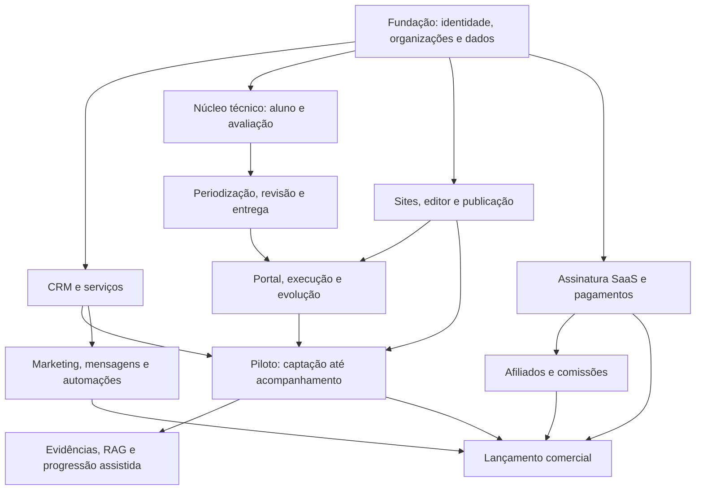

# Trainer Prescription — roadmap e handoff

Referência principal: [01-PROJETO-CONSOLIDADO.md](01-PROJETO-CONSOLIDADO.md). Planejamento de 23/10/2026; nenhuma implementação ou teste foi executado nesta etapa.

## 1. Estratégia de entrega

Implementar por jornadas completas e verificáveis, evitando construir todas as telas com dados fictícios antes de validar autorização, persistência e publicação. Os marcos abaixo indicam dependências; não são estimativas de semanas e não autorizam excluir requisitos do projeto consolidado.

Dois marcos de produto:

- **Piloto operacional:** um profissional publica seu site, recebe um interessado, cadastra/avalia o aluno, entrega uma prescrição revisada e acompanha a execução e a evolução no portal.
- **Lançamento comercial com paridade ampliada:** soma SaaS, afiliados, marketing/integradores, equipe/unidades e gestão aplicável ao Carbud, com estados reais de disponibilidade. Integrações sem credencial/acesso não contam como prontas.

Não adiar segurança, isolamento, aprovação humana, versionamento ou observabilidade para uma fase posterior à entrada de dados reais. IA/RAG pode evoluir após o motor determinístico; área do aluno e acompanhamento são parte do piloto, não um apêndice futuro.

## 2. Mapa de dependências

SaaS e integrações podem ser desenvolvidos enquanto o núcleo técnico evolui, mas ativação comercial depende do produto operacional. Regra de prescrição nunca depende de o pixel, gateway ou provedor de e-mail estar disponível.

## 3. Épicos e critérios de saída

### E0 — Arquitetura e prova de viabilidade

Entregas:

- Confirmar checkout, protótipos e dados existentes; separar implementação disponível de requisitos escritos.
- Registrar decisões de stack, organização/roles, domínios privados, login central e duração real dos ciclos.
- Prova com dois hosts públicos, dois hosts de portal e duas organizações; login, logout, recuperação e escopo sem vazamento.
- Prova de persistência PostgreSQL/RLS, upload privado, job durável e PDF server-side no runtime selecionado.
- Confirmar APIs da versão Puck escolhida e interoperabilidade editor/renderer.

Saída: limitações conhecidas e decisões registradas, sem depender de cookies compartilhados entre domínios distintos ou de tarefas que morrem após uma resposta HTTP.

### E1 — Fundação multi-tenant e controle de acesso

Entregas:

- Identidade, organizações, memberships, profissionais, unidades, vínculo do aluno e responsáveis técnicos.
- Convites, recuperação, revogação, permissões, escopo de suporte e auditoria.
- Banco/migrations, storage público e privado, validações de vínculo e outbox/jobs.
- Tokens visuais, layout responsivo e navegação das áreas.
- Contexto de tenant autenticado e políticas RLS efetivas nos caminhos reais de acesso.

Saída: usuário de A não acessa B por alteração de ID, hostname, payload, URL de arquivo, job ou cache. Usuário comercial/financeiro de A não acessa avaliação só por pertencer a A.

### E2 — Atendimento e prescrição com paridade dos anexos

Entregas:

- Cadastro do aluno, anamnese/triagem, avaliações e métricas estruturadas.
- Biblioteca global/privada, seed identificado e revisão dos vídeos.
- Macrociclo, mesociclos, microciclos, grupos musculares, splits, rotação e alvo por treino.
- Motor determinístico e presets configuráveis; justificativas e alertas reais.
- Edição por mesociclo, origem dos campos, regeneração com diff e preservação humana.
- Revisões, aprovação e entrega com snapshot imutável; PDF privado versionado.

Saída: fluxo do documento mestre executável sem planilha; ajustes de uma fase não alteram outras; nenhum plano em rascunho/revisão aparece como entregue.

### E3 — Site e aquisição mínima

Entregas:

- Perfil profissional, ofertas de serviço e site em host da plataforma.
- Puck com blocos iniciais, colunas, propriedades, edição inline, controle acessível e preview.
- Draft persistido, concorrência otimista, revisão, release e rollback.
- Renderer compartilhado, SEO, sitemap, canonical, formulário com captura de origem e CTA para o portal.
- Cadastro/verificação de domínio próprio e DNS/TLS/HTTP; aliases e reconciliação de falhas.
- CRM mínimo: lead, origem, responsável, etapas, tarefa e conversão para aluno/contrato sem duplicidade.

Saída: dois profissionais publicam conteúdos diferentes sem projetos/deployments por cliente; rascunho nunca vaza; lead recebe owner pelo host; cliente real consegue chegar ao vínculo de aluno.

### E4 — Portal e acompanhamento: fechamento do piloto

Entregas:

- Acesso pelo site com a marca do personal e autenticação na origem privada proposta.
- Convite e vínculo; aluno vê apenas planos/revisões liberados.
- Treino atual, vídeos, execução por exercício/série, observações e conclusão idempotente.
- Histórico, evolução por métrica, check-ins e feedback profissional.
- Agenda interna, avaliações/reavaliações previstas e notificações essenciais.
- Documentos autorizados, preferências e solicitações de dados.

Saída: o profissional recebe execução real ligada ao plano original, compara com o prescrito, reavalia e entrega uma nova revisão sem apagar o histórico. Sem pixel, GTM ou acesso cruzado no portal.

### E5 — Gestão comercial e paridade de marketing

Entregas:

- Funil completo, distribuição de leads, tarefas, timeline e relatórios.
- WhatsApp, conversas, templates, e-mails de convite/aviso e preferências.
- UTMs, Meta Pixel/CAPI, GA4/Measurement Protocol, Ads e GTM no contexto público, com consentimento e escopo apropriados.
- API keys por finalidade e webhooks assinados com retries; não exportar avaliações por escopo comercial genérico.
- Gestão de equipe/unidades e permissões avançadas.
- Contratos do aluno, recebimentos manuais e renovação; proposta e acompanhamento comercial.
- Automação limitada por evento, destinatário, horário e frequência; painel de falhas.

Saída: capacidades adaptáveis do Carbud estão cobertas pela matriz de rastreabilidade e cada integração tem teste real no ambiente de homologação ou status de dependência externa explícito. Não marcar a etapa concluída com apenas configurações salvas.

### E6 — SaaS e afiliados

Entregas:

- Planos SaaS, limites aplicados no servidor, cupons, trial e assinatura manual/gateway.
- Fatos financeiros normalizados, webhooks duráveis, conciliação e política de inadimplência.
- Cadastro administrativo do afiliado, código único e percentual explícito.
- Código na contratação SaaS e atribuição de origem por organização.
- Comissão recorrente por pagamento confirmado, ajustes, retenções e repasses registrados.
- Painel do afiliado integrado à identidade, com seus resultados e nenhuma informação de alunos.

Saída: confirmação e recebimento da mesma cobrança geram um crédito; replay/concorrência/estorno preservam saldo e histórico. Falha de webhook é recuperável e não duplica pagamento ou comissão. Receita do SaaS e dos profissionais não se mistura.

Observação: o documento histórico de afiliados previa portal como fase 2 do módulo. Neste projeto completo, ele continua uma entrega distinta, mas já está incluído no roadmap comercial; não tratar sua previsão como funcionalidade pronta.

### E7 — Evoluções planejadas

Entregas incrementais, preservando o objetivo final:

- RAG com corpus autorizado e citações conferíveis; explicação e trilha de geração.
- Progressão assistida por microciclo e resposta executada, sempre revisável.
- Booking público e sincronização de calendário; cobrança online dos alunos por conta de recebedor.
- Mais templates/blocos e experiências de campanha, mantendo contrato versionado.
- PWA/offline com política de dados e conflitos definida, se houver necessidade validada.
- Métricas avançadas de retenção/coortes e automações adicionais.

Não incluir automaticamente diagnóstico por imagem, dieta, medicamentos, wearables, aplicativo nativo, marketplace público de profissionais ou comissão multinível. São produtos/integrações novos que exigem escopo próprio.

## 4. Contratos mínimos entre módulos

| Evento de domínio | Produzido por | Consumidores e regra |
|---|---|---|
| `LeadCaptured` | Formulário/API comercial | CRM, tarefa e aviso; sem dados de saúde |
| `LeadConverted` | Comercial autorizado | Criação/vínculo de aluno/contrato; não aprova plano nem confirma pagamento |
| `StudentAccessGranted` | Atendimento/identidade | Convite e portal daquela organização |
| `AssessmentRecorded` | Atendimento | Triagem, pendências e reavaliação; nunca pixel |
| `PlanApproved` | Profissional autorizado | Registro de revisão aprovada; ainda pode não estar liberada |
| `PlanDelivered` | Entrega | Portal/PDF/notificação da revisão específica |
| `TrainingSessionCompleted` | Aluno autenticado | Acompanhamento e métricas privadas; não atribuição publicitária |
| `CheckInSubmitted` | Aluno autenticado | Fila do profissional com prioridade definida |
| `SitePublished` | Editor autorizado | Troca de release e invalidação pública; não novo projeto Vercel |
| `SaasPaymentConfirmed` | Conciliação financeira | Acesso SaaS e apuração de afiliado idempotentes |
| `StudentPaymentConfirmed` | Financeiro da organização | Contrato/recebimento do aluno; não comissão SaaS |
| `PaymentAdjusted` | Conciliação | Recomputar direito líquido e lançar ajuste, sem apagar lançamento anterior |

Cada evento tem ID, data efetiva, versão de schema, organizationId pertinente, ator/origem, chave de negócio e correlação. Payload mínimo; consumidores fazem sua própria autorização/validação. Inserção no outbox acompanha a transação do fato. Reentrega é esperada; efeitos precisam ser idempotentes.

## 5. Cenários de aceite ponta a ponta

### Jornada do profissional e aluno

1. Profissional contrata, entra no workspace e configura sua identidade e serviços.
2. Edita e publica o site; domínio e CTA de Área do aluno funcionam.
3. Interessado envia formulário; CRM captura host, serviço e origem corretamente.
4. Equipe atende e converte; o mesmo envio/retry não gera dois alunos.
5. Aluno recebe convite e preenche dados autorizados; profissional registra avaliação.
6. Profissional cria planejamento de seis fases com splits distintos e gera rascunhos próprios.
7. Edita exercício/vídeo manualmente; regeneração preserva essas escolhas.
8. Resolve pendências, aprova e entrega revisão; PDF e portal exibem os mesmos dados liberados.
9. Aluno registra treino realizado, feedback e medida; profissional vê resultados e origem dos dados.
10. Nova revisão é entregue; execução antiga continua ligada ao plano antigo e os gráficos permanecem coerentes.

### Jornada de afiliado

1. Plataforma cadastra afiliado com código único e percentual.
2. Profissional informa código na contratação SaaS; origem fica vinculada à organização.
3. Confirmação gera comissão; recebimento posterior, replay e processamento concorrente não duplicam.
4. Renovação confirmada gera novo crédito com termos aplicáveis.
5. Estorno parcial/integral ajusta direito líquido; repasse já registrado permanece rastreável.
6. Afiliado vê apenas seus números e organizações com os campos mínimos autorizados.

### Jornada editorial e publicação

1. Dois editores abrem a mesma revisão; alteração concorrente gera conflito recuperável.
2. Draft com colunas/blocos e assets autorizados publica um release coerente.
3. Documento inválido não substitui a versão pública anterior.
4. Rollback restaura conteúdo por novo release, sem destruir histórico.
5. Alteração de componente incompatível exige migração ou renderer compatível com documentos anteriores.
6. Domínio desconhecido não abre site de fallback; falha parcial Vercel/banco é reconciliável.

## 6. Testes técnicos por fronteira

### Autorização e privacidade

- Acesso cruzado por organização, profissional, aluno, afiliado, ID de arquivo e host.
- Mesma identidade em dois vínculos sem união de dados privados.
- Comercial/financeiro sem acesso técnico; suporte sem acesso universal.
- Revogação de membership/vínculo/sessão impede operações futuras.
- Callback adulterado, replay de código de login, open redirect, CSRF e origem pública tentando chamar portal privado.
- RLS testada com os papéis realmente usados; credencial de serviço não mascara ausência de autorização no servidor.
- Nenhum dado de aluno entra em DTO público, pixel, metadata, sitemap ou cache compartilhado.

### Motor e histórico

- 3/6/12 fases; 1–7 sessões; splits, alvos e rotação conforme referência.
- Cronograma sem sobreposição silenciosa; datas exibem duração real e fuso correto.
- Candidatos insuficientes retornam pendência, sem exercício proibido ou duplicado para completar quantidade.
- Revisão necessária não aprova/entrega automaticamente; aprovação não elimina flags históricas.
- Vídeo editado só na prescrição não altera biblioteca e vice-versa.
- Regeneração não perde edição humana; cópia entre fases não cria referência mutável comum.
- Execução/PDF ligados à revisão exata; edição/exclusão de biblioteca não corrompe documentos anteriores.
- Métrica sem dado não vira zero; unidades/metodologias diferentes não são agregadas como equivalentes.

### Sites e operações assíncronas

- Arraste/reordenação e alternativa por teclado/toque; bloqueio de ciclos na árvore de componentes.
- Preview privado e sem analytics reais; publicado só retorna release autorizado.
- Assets de outro tenant e URLs perigosas são recusados; upload privado nunca chega ao rewrite público.
- Job com retry, timeout e falha permanente tem estado visível e resultado idempotente.
- Teste de restauração de backup, exportação, expiração de links e invalidação de publicação.

### Financeiro e integrações

- Fatos por provedor/conta/ambiente/ID, separando sandbox de produção.
- Confirmação/recebimento em ordem invertida e callbacks atrasados após estorno.
- Falha entre evento e efeito, reprocessamento, estorno parcial repetido e concorrência de repasse.
- Cupom não altera origem; cancelamento/troca de plano não troca afiliado.
- Gateway indisponível não apaga indicação, cria dívida fictícia ou aprova treino.
- Eventos de navegador/servidor seguem deduplicação de cada fornecedor e não enviam campos sensíveis.
- WhatsApp/e-mail: permissão, templates, preferências, retry, status e separação entre tenants.

## 7. Entregáveis exigidos do coding agent

Para cada épico concluído, entregar:

- Código integrado ao domínio e padrões escolhidos, sem mocks apresentados como produção.
- Migrations aditivas e estratégia de atualização de schemas/documentos.
- Rotas, telas, permissões e jobs necessários ao fluxo completo.
- Testes pertinentes com resultado real e limitações ambientais explícitas.
- Configuração necessária sem segredos em repositório/logs.
- Documentação de startup, publicação, tarefas e recuperação de falhas.
- Atualização da matriz de funcionalidades: implementado, validado, dependente de fornecedor ou planejado.

Não usar uma suite unitária verde como evidência de login cross-domain, TLS, pagamento real, atomicidade de banco ou entrega de WhatsApp. Validar a fronteira correspondente em homologação e manter os resultados distintos.

## 8. Diretrizes de reaproveitamento e migração

- Carbud é referência de padrões e componentes; nova aplicação deve nascer com linguagem/modelo próprios, sem tabelas de veículos ocultas atrás de rótulos de aluno.
- Revisar componentes genéricos de UI, máscaras, datas, autorização conceitual, auditoria, gateway, domínios, CRM e tracking. Portar dependências somente após checar compatibilidade.
- Corrigir os limites conhecidos: marcação prematura de webhook, idempotência insuficiente por pagamento, status ativo inferido sem TLS e resolução de domínio sem estado de publicação.
- Não copiar snapshots/segredos/dados de produção do Carbud para a aplicação de trainers.
- Protótipos HTML são referência de comportamento. Importações futuras passam por staging, validação, deduplicação e relatório. Nunca tratar um dump de `localStorage` como pertencente automaticamente ao usuário que o envia.
- Manter os dados antigos/revisões recuperáveis ao migrar; ensaio de restauração antes de promover alteração estrutural.

## 9. Prompt de handoff sugerido

> Estruture e implemente o Trainer Prescription seguindo `01-PROJETO-CONSOLIDADO.md`, este roadmap e a matriz de rastreabilidade. O produto une a gestão/marketing aplicável do Carbud ao domínio de treinamento dos anexos e à área do aluno integrada à marca/site do profissional. Não há domínio automotivo. Preserve periodização por mesociclo, revisão humana, versões entregues imutáveis e execução ligada à revisão. Separe organização, profissional, aluno, lead, contrato do aluno, plano de treino, assinatura SaaS e afiliado. Comissão é percentual recorrente sobre pagamentos SaaS confirmados e código é capturado na contratação. Construa por épicos verificáveis; não anuncie integrações, RAG, portal ou pagamentos como prontos sem evidência. Antes de alterar implementação existente, confira o checkout e registre decisões propostas ainda não confirmadas. Os anexos históricos detalham a referência funcional; exclusões antigas de portal/cobrança não anulam o escopo atualizado. Comece pela fundação e pelas provas de autenticação/domínio/dados, depois feche o piloto completo antes de expandir automações.

Este prompt é material para futura execução em outro ambiente. Nesta conversa, o trabalho realizado foi apenas planejamento e documentação.
